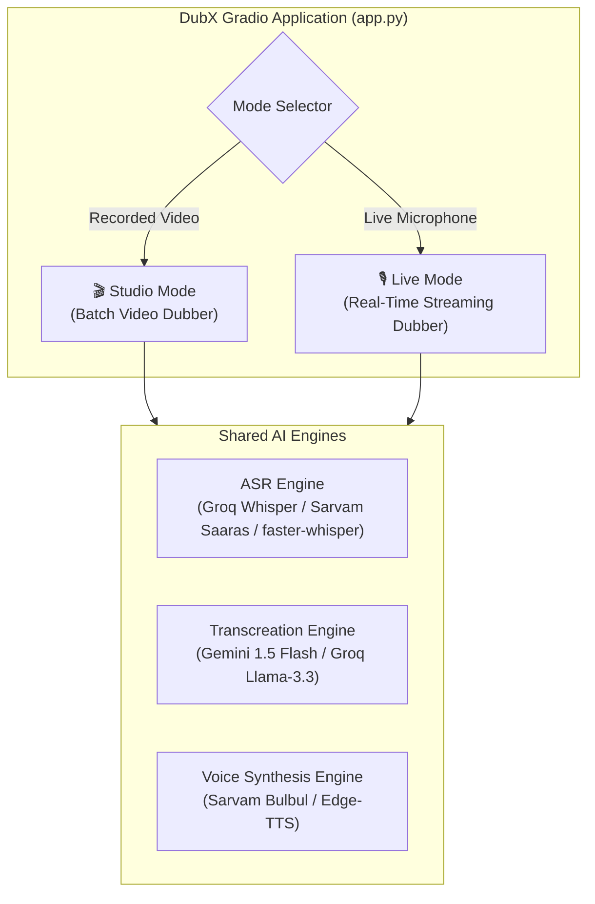
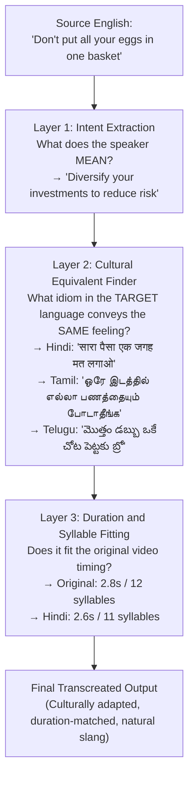
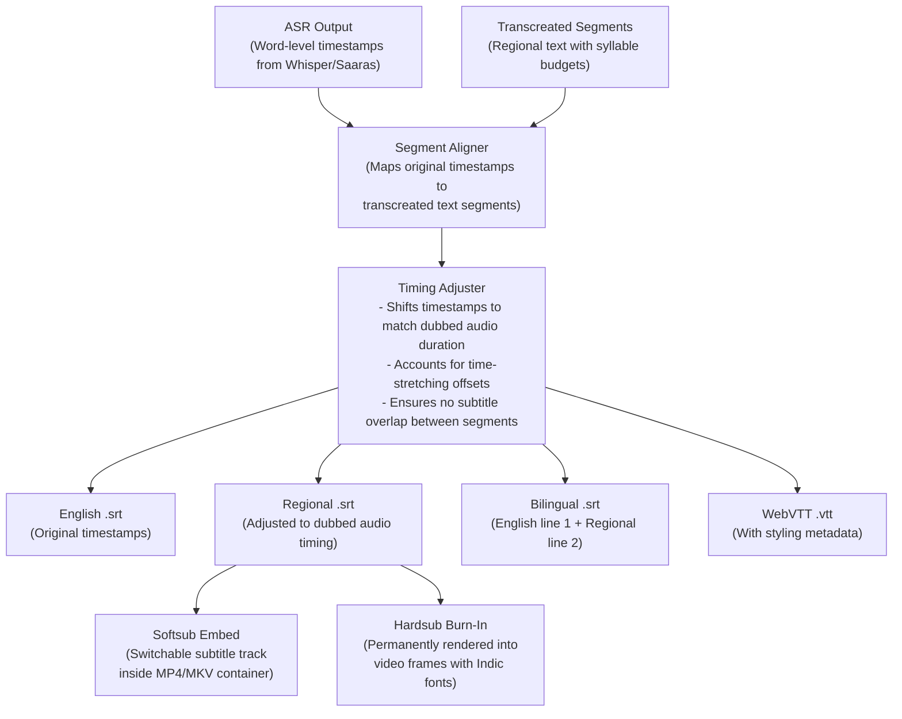
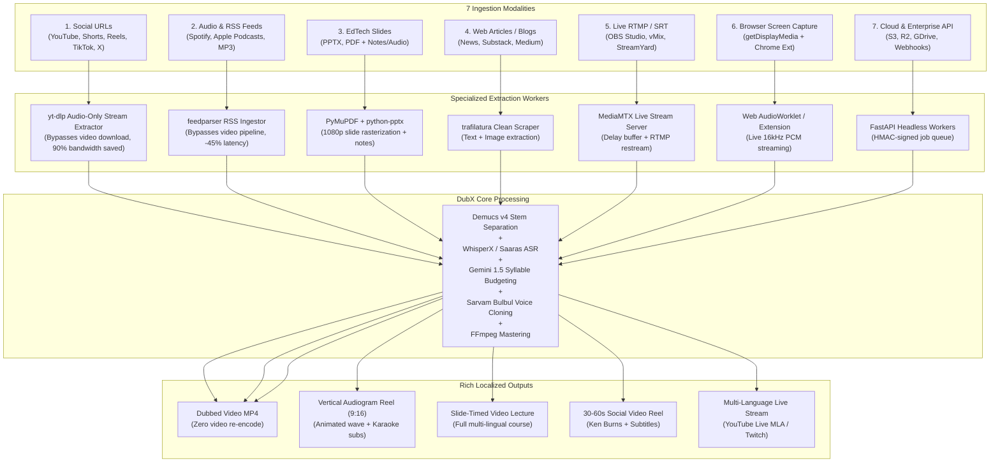
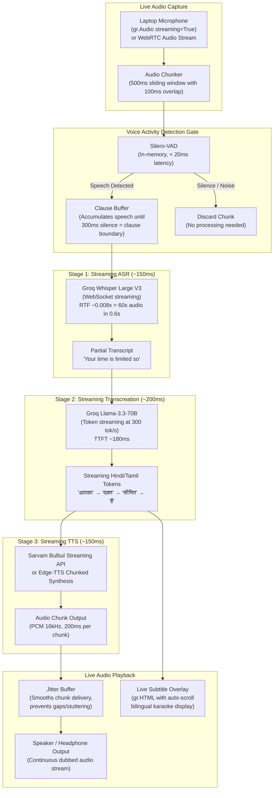

```mermaid
flowchart TD
    subgraph Input["Phase 0: Ingestion"]
        V["Video Input\n(MP4 Upload / YouTube URL)"]
        V --> YT["yt-dlp Downloader\n(if YouTube URL)"]
        YT --> SRC["source_video.mp4"]
        V -->|Direct Upload| SRC
    end

    subgraph Phase1["Phase 1: Extraction & Transcreation"]
        SRC --> DEMUX["Step 1: FFmpeg Audio Extraction\nffmpeg -vn -acodec pcm_s16le audio.wav"]
        DEMUX --> DEMUCS["Step 2: Demucs v4 Neural Stem Separation\ndemucs --two-stems=vocals audio.wav"]

        DEMUCS --> VOC["vocals.wav\n(Isolated Human Dialogue)"]
        DEMUCS --> BGM["bgm.wav\n(Background Music + SFX + Ambience)"]

        VOC --> ASR["Step 3: Speech-to-Text\n(Groq Whisper Large V3 — sub-1s)\n↳ Fallback: Sarvam Saaras (Indic code-mixing)\n↳ Fallback: faster-whisper (offline)"]
        ASR --> SEG["Word-Level Timestamped Segments\n[{id:1, start:0.0, end:2.4, text:'Your time is limited'}]"]

        SEG --> BUDGET["Step 4a: Syllable Budget Calculator\nTarget = duration × 4.0 syllables/sec\nClamped to ±15% of English syllable count"]
        BUDGET --> TRANS["Step 4b: Gemini 1.5 Flash Transcreation\nDuration-constrained prompt:\n'Translate to colloquial Hindi in ≤14 syllables'"]
        TRANS --> SEGMENTS["Transcreated Segments\n[{id:1, original:'Your time is limited',\n  translated:'आपका वक़्त सीमित है भाई',\n  budget:12, actual:11, pacing:0.92x, status:'🟢'}]"]
    end

    subgraph HITL["Phase 2: Human-in-the-Loop Review"]
        SEGMENTS --> DF["Gradio Editable Dataframe\n(gr.Dataframe interactive=True)"]
        DF --> EDIT["User Reviews & Edits:\n- Fix cultural idioms\n- Adjust syllable pacing\n- AI Auto-Trim flagged segments"]
        EDIT --> APPROVED["Approved Script\n(Locked segments with final translations)"]
    end

    subgraph Phase3["Phase 3: Voice Synthesis & Audio Mastering"]
        APPROVED --> CLONE["Step 5: Voice Clone TTS\n(Per-Segment Synthesis)"]
        VOC -.->|Reference Voice Embedding| CLONE

        CLONE --> PRIMARY["Primary: Sarvam Bulbul V3\n(Native Indian cadence, ₹100 free credits)"]
        CLONE --> FALLBACK["Fallback: Edge-TTS\n(100% free, zero API key)\nhi-IN-MadhurNeural / ta-IN-ValluvarNeural"]

        PRIMARY --> RAW["Raw Dubbed Audio Segments\nseg_001.wav, seg_002.wav, ..."]
        FALLBACK --> RAW

        RAW --> STRETCH["Step 6: Per-Segment Time-Stretching\n(pyrubberband phase-vocoder)\nClamp: 0.85x to 1.18x speed ratio"]
        STRETCH --> CONCAT["Concatenated Dubbed Vocal Track\ndubbed_vocals.wav"]

        CONCAT --> DUCK["Step 7: Dynamic Sidechain Ducking\n(FFmpeg sidechaincompress)"]
        BGM --> DUCK

        DUCK --> MASTER["Mastered Audio\n(Voice loud & clear + BGM ducked -10dB during speech,\nswells back up during pauses)"]
    end

    subgraph Phase4["Phase 4: Final Render & Export"]
        MASTER --> REMUX["Step 8: FFmpeg 1-Pass Remux\n-c:v copy (zero video re-encoding)\n-c:a aac -b:a 192k"]
        SRC -.->|Original Video Stream| REMUX

        SEGMENTS --> SUBS["Step 9: Subtitle Generation\n.srt + .vtt with Noto Sans Indic\n(HarfBuzz complex ligature shaping)"]

        REMUX --> FINAL["final_dubbed_video.mp4"]
        SUBS --> SRT["subtitles.srt / subtitles.vtt"]
    end

    subgraph Output["Phase 5: Output & Comparison"]
        FINAL --> PLAYER["Synchronized Side-by-Side Player\n(Original vs Dubbed)"]
        FINAL --> AB["Mid-Playback A/B Audio Switcher\n[🇬🇧 English] ↔ [🇮🇳 Tamil]"]
        FINAL --> DL["Downloads: MP4, SRT, VTT, Stems ZIP"]
        SRT --> PLAYER
    end
```

# DubX — Dual-Mode Architecture: Studio + Live Real-Time

---

## System Overview

DubX operates as a **Dual-Mode AI Dubbing Studio** inside a single Gradio application. Both modes share core AI engines but differ fundamentally in **data flow, latency targets, and BGM handling**.



### 🎨 Product Experience & Design Philosophy

> **"Designed with the clean, minimalist, and tool-focused simplicity of iLovePDF, our web platform turns video dubbing into Indian regional languages into an effortless, one-click experience. Users can seamlessly supply content using three flexible input methods: uploading a local video file, recording directly through a live camera, or pasting a video URL. Once processed by our translation engine, the platform offers three distinct output choices: downloading the fully dubbed regional video, extracting just the localized audio track as a standalone file, or generating a complete text transcript of the translated speech in the chosen regional language. Whether for content creators, educators, or media teams, this streamlined tool removes complex software barriers and makes multi-format regional content localization accessible to anyone in seconds."**

```
┌──────────────────────────────────────────────────────────────────────────────────┐
│                   THE 3-INPUT ➔ 3-OUTPUT SIMPLICITY MODEL                        │
│                                                                                  │
│  INPUT METHODS:                                                                  │
│    1. 📁 Local Video File Upload (MP4, MOV, MKV)                                 │
│    2. 📹 Live Camera & Mic Recording (Direct In-Browser)                          │
│    3. 🔗 Video URL (YouTube, Shorts, Reels, TikTok, X)                           │
│                                      ↓                                           │
│                 ⚡ DubX Regional AI Transcreation Engine                         │
│                                      ↓                                           │
│  OUTPUT CHOICES:                                                                 │
│    1. 🎬 Fully Dubbed Regional Video (Dubbed audio + Preserved BGM + Subtitles)  │
│    2. 🎧 Standalone Localized Audio Track (M4A / MP3 for podcasts & YouTube MLA) │
│    3. 📄 Complete Translated Text Transcript (SRT, VTT, TXT in regional script)  │
└──────────────────────────────────────────────────────────────────────────────────┘
```

---

## Mode 1: 🎬 Studio Mode (Batch Video Dubber)

### Purpose
Dub pre-recorded videos (YouTube, MP4 uploads, EdTech lectures) with **maximum quality**, background music preservation, human review of translations, and polished final export.

### Target Latency
- **10 to 25 seconds** for a 60-second video (acceptable — user waits for a polished output).

### Architecture Diagram



### Detailed Step-by-Step Data Flow

| Step | What Happens | Input | Output | Engine | Latency |
| :--- | :--- | :--- | :--- | :--- | :--- |
| **1** | Extract audio from video container | `source.mp4` | `audio.wav` (PCM 44.1kHz) | FFmpeg | ~0.1s |
| **2** | Separate voice from background music using neural network | `audio.wav` | `vocals.wav` + `bgm.wav` | Demucs v4 (HTDemucs) | ~4–8s |
| **3** | Transcribe voice with word-level timestamps | `vocals.wav` | `[{start, end, text}]` JSON segments | Groq Whisper / Sarvam | ~0.8s |
| **4a** | Calculate syllable budget per segment | Segments + durations | Target syllable count per segment | Local Python (Akshara counter) | ~0.01s |
| **4b** | Translate with duration constraints and colloquial style | English segments + budgets | Regional translated segments | Gemini 1.5 Flash | ~0.5–1.0s |
| **5** | *(User Review)* Edit translations in interactive table | Dataframe | Approved locked segments | Human | User-paced |
| **6** | Synthesize regional speech in the speaker's cloned voice | Translated text + reference voice | `seg_001.wav, seg_002.wav, ...` | Sarvam Bulbul / Edge-TTS | ~1.5–3.0s |
| **7** | Time-stretch each segment to fit original video timing | Raw TTS segments + target durations | Duration-matched segments | pyrubberband | ~0.3s |
| **8** | Duck BGM during speech, swell during pauses | `dubbed_vocals.wav` + `bgm.wav` | `mastered_audio.m4a` | FFmpeg sidechaincompress | ~1.2s |
| **9** | Remux mastered audio with original video (no re-encode) | Video stream + mastered audio | `final_dubbed.mp4` | FFmpeg `-c:v copy` | ~0.3s |
| **10** | Generate bilingual subtitle files | Timestamped segments | `.srt` + `.vtt` | pysrt + Noto Sans | ~0.05s |

### How Background Music Is Retained (Studio Mode)

```
Original Mixed Audio:  ██████████ VOICE ██████████ BGM ██████████ SFX ██████████

                              ↓ Demucs v4 Neural Separation ↓

Isolated Vocals:       ██████████ VOICE ██████████ .......... ██████████ ..........
Isolated BGM + SFX:    .......... .......... ██████████ BGM ██████████ SFX ██████████

                              ↓ AI Dubbing Pipeline (ASR → Translate → TTS) ↓

New Regional Vocals:   ██████████ हिंदी VOICE █████████ .......... ██████████ ..........

                              ↓ Sidechain Ducking (FFmpeg) ↓

Final Mastered Audio:  ██ हिंदी VOICE (LOUD) ██ BGM (DUCKED -10dB) ██ BGM (FULL) ██ SFX ██
                       ↑ Voice is clear            ↑ Music dips         ↑ Music swells back
```

---

## The Transcreation Engine: Preserving Metaphors, Idioms & Meaning Across All Regional Languages

### The Core Problem: Translation Destroys Meaning

Standard AI translation (Google Translate, DeepL, even basic LLM calls) produces **literal word-for-word output** that destroys the speaker's intent. In dubbing, this is fatal — the audience hears nonsensical phrases and immediately disconnects.

| Original English | ❌ Literal Translation (Hindi) | What It Actually Means | ✅ DubX Transcreation (Hindi) |
| :--- | :--- | :--- | :--- |
| *"That's a steal at this price!"* | *"इस कीमत पर यह एक चोरी है!"* (This is a theft!) | It's a great bargain | *"इस कीमत पर तो लूट मची है भाई!"* |
| *"He hit it out of the park"* | *"उसने इसे पार्क से बाहर मारा"* (Physically hitting a park) | He did an exceptional job | *"उसने तो कमाल कर दिया!"* |
| *"Don't put all your eggs in one basket"* | *"अपने सभी अंडे एक टोकरी में मत रखो"* (Literally about eggs) | Diversify your risk | *"सारा पैसा एक जगह मत लगाओ"* |
| *"The market is on fire"* | *"बाज़ार में आग लगी है"* (The market is literally burning) | The market is booming | *"बाज़ार में तो धूम मची है!"* |
| *"Bear market incoming"* | *"भालू बाज़ार आ रहा है"* (A bear animal market) | Stock market decline | *"मंदी आने वाली है भाई"* |

DubX does **not** translate. It **transcreates** — preserving the **intent, emotion, rhetorical device, and cultural impact** of every sentence.

---

### 3-Layer Transcreation Pipeline



---

### Per-Language Cultural Profiles

Every language has its own **soul** — the same English metaphor requires a **different cultural equivalent** in Hindi vs Tamil vs Telugu vs Bengali. There is no universal "Indian translation."

#### Language Profile Configuration (used by Gemini 1.5 Flash)

| Language | Dialect Used | Casual Tone Markers | Proverb Style | Keep English As-Is |
| :--- | :--- | :--- | :--- | :--- |
| **Hindi** | Conversational North Indian with Hinglish code-mixing | *bhai, yaar* (भाई, यार) | Hindi muhavare (मुहावरे), NOT Sanskrit shlokas | subscribe, like, share, portfolio, mutual fund, SIP, returns, market |
| **Tamil** | Spoken colloquial Tamil (பேச்சுத் தமிழ்), NOT literary Sentamizh | *da, di, pa* (டா, டி, பா) | Tamil pazhamozhi (பழமொழி) + Chennai slang | subscribe, like, share, phone, app, invest, stock market |
| **Telugu** | Conversational Hyderabadi / Coastal Telugu with modern slang | *bro, ra, ri* (బ్రో, రా, రి) | Telugu saamethalu (సామెతలు) + Tollywood references | subscribe, like, share, invest, market, feature, update |
| **Bengali** | Colloquial Kolkata Bengali (চলিত ভাষা), NOT Sadhu Bhasha | *re, tui* (রে, তুই) | Bengali probad (প্রবাদ) + Bangla cinema references | subscribe, like, share, invest, market, phone, online |
| **Kannada** | Spoken Bengaluru Kannada with modern slang | *maga, guru* (ಮಗಾ, ಗುರು) | Kannada gadegalu (ಗಾದೆಗಳು) + local references | subscribe, like, share, invest, app, update, feature |
| **Marathi** | Colloquial Puneri / Mumbai Marathi | *re, ya* (रे, या) | Marathi mhani (म्हणी) + cultural references | subscribe, like, share, invest, market, SIP, returns |

---

### Cross-Language Metaphor Adaptation Examples

#### One Sentence → Six Different Transcreations:

**English:** *"Don't put all your eggs in one basket"*

| Language | ❌ Literal Translation | ✅ DubX Transcreation |
| :--- | :--- | :--- |
| **Hindi** | अपने सभी अंडे एक टोकरी में मत रखो | **सारा पैसा एक जगह मत लगाओ भाई** |
| **Tamil** | உங்கள் முட்டைகளை ஒரு கூடையில் வைக்காதீர்கள் | **ஒரே இடத்தில் எல்லா பணத்தையும் போடாதீங்க** |
| **Telugu** | మీ గుడ్లన్నీ ఒకే బుట్టలో పెట్టకండి | **మొత్తం డబ్బు ఒకే చోట పెట్టకు బ్రో** |
| **Bengali** | সব ডিম এক ঝুড়িতে রেখো না | **সব টাকা এক জায়গায় ঢালিস না রে** |
| **Kannada** | ನಿಮ್ಮ ಮೊಟ್ಟೆಗಳನ್ನೆಲ್ಲಾ ಒಂದೇ ಬುಟ್ಟಿಯಲ್ಲಿ ಇಡಬೇಡಿ | **ಎಲ್ಲಾ ದುಡ್ಡನ್ನ ಒಂದೇ ಕಡೆ ಹಾಕಬೇಡ ಮಗಾ** |
| **Marathi** | तुमची सगळी अंडी एकाच टोपलीत ठेवू नका | **सगळा पैसा एकाच ठिकाणी लावू नकोस रे** |

#### Tech Creator Context (MKBHD style):

| English | Hindi | Tamil | Telugu |
| :--- | :--- | :--- | :--- |
| *"This phone is a beast!"* | *"ये फोन तो जानवर है भाई!"* | *"இந்த போன் ஒரு மிருகம் டா!"* | *"ఈ ఫోన్ ఒక బీస్ట్ రా!"* |
| *"It blew my mind"* | *"मेरा दिमाग हिल गया"* | *"என் மண்டையே போச்சு டா"* | *"నా బుర్ర పనిచేయడం ఆపేసింది"* |
| *"This feature is a game changer"* | *"ये फीचर तो गेम चेंजर है"* | *"இந்த ஃபீச்சர் கேம் சேஞ்சர் டா"* | *"ఈ ఫీచర్ గేమ్ చేంజర్ బ్రో"* |

#### Finance Creator Context:

| English | Hindi | Tamil | Bengali |
| :--- | :--- | :--- | :--- |
| *"The market is on fire!"* | *"मार्केट में तो धूम मची है!"* | *"மார்க்கெட் தீ பிடிச்சு எரியுது!"* | *"মার্কেটে আগুন লেগেছে রে!"* |
| *"This stock is a hidden gem"* | *"ये स्टॉक छुपा हुआ हीरा है"* | *"இந்த ஸ்டாக் ஒரு hidden gem டா"* | *"এই স্টকটা লুকানো রত্ন রে"* |
| *"Don't chase returns blindly"* | *"आंख बंद करके रिटर्न्स के पीछे मत भागो"* | *"கண்ணு மூடி ரிட்டர்ன்ஸ் பின்னாடி ஓடாதீங்க"* | *"চোখ বুজে রিটার্নের পেছনে ছুটিস না"* |

#### Motivational / Emotional Context:

| English | Hindi | Tamil | Telugu | Marathi |
| :--- | :--- | :--- | :--- | :--- |
| *"Stay hungry, stay foolish"* | *"जुनून मत छोड़ो, हिम्मत मत हारो"* | *"ஆர்வத்தை விடாதீர்கள், துணிச்சலை இழக்காதீர்கள்"* | *"ఆకలిగా ఉండు, సాహసంగా ఉండు"* | *"जिद्द सोडू नकोस, धाडस हरवू नकोस"* |
| *"Your time will come"* | *"तेरा टाइम आएगा भाई"* | *"உன் நேரம் வரும் டா"* | *"నీ టైం వస్తుంది రా"* | *"तुझा वेळ येईल रे"* |
| *"Fall seven times, stand up eight"* | *"सात बार गिरो, आठवीं बार उठो"* | *"ஏழு தடவை விழு, எட்டாவது தடவை எழு"* | *"ఏడు సార్లు పడు, ఎనిమిదో సారి లే"* | *"सात वेळा पड, आठव्यांदा उभा रहा"* |

---

### The 7 Transcreation Rules (Enforced via Gemini System Prompt)

These rules are dynamically injected into the Gemini 1.5 Flash system prompt for every transcreation request:

```
RULE 1: NEVER TRANSLATE LITERALLY
  → You are a TRANSCREATOR, not a translator.
  → Preserve INTENT, EMOTION, and RHETORICAL IMPACT — NOT individual words.

RULE 2: METAPHOR → CULTURAL EQUIVALENT
  → English metaphor → Find the EQUIVALENT metaphor in the target language.
  → "Piece of cake" → Hindi: "बाएं हाथ का खेल" (NOT "केक का टुकड़ा")
  → "Break a leg" → Tamil: "வெற்றி பெறு டா" (NOT "காலை உடை")

RULE 3: PROVERBS → PROVERBS
  → Map to the equivalent regional proverb with the SAME moral lesson.
  → Never translate a proverb word-for-word.

RULE 4: HUMOR & SARCASM PRESERVATION
  → Sarcastic tone MUST sound equally sarcastic in the regional language.
  → "Oh great, another meeting" → Hindi: "वाह, एक और मीटिंग... क्या बात है"

RULE 5: TECHNICAL JARGON HANDLING
  → Keep universally understood terms as-is in regional script:
    "portfolio" → "पोर्टफोलियो" (NOT "विभाग")
    "mutual fund" → "म्यूचुअल फंड" (NOT "पारस्परिक निधि")
    "subscribe" → "सब्सक्राइब" (NOT "सदस्यता लें")
  → This is how real Indian creators speak (Hinglish / Tanglish / Tenglish).

RULE 6: EMOTIONAL MARKERS
  → Preserve exclamation marks, rhetorical questions, dramatic pauses
    in the exact same sentence positions.
  → "And you know what happened next?!" → "और फिर पता है क्या हुआ?!"

RULE 7: SYLLABLE BUDGET
  → Output MUST be speakable within the original segment's duration.
  → Target: ~4 syllables/second for Indic languages.
  → If the natural translation is too long, SHORTEN it using punchy
    vernacular phrasing while keeping the core meaning.
```

---

### Why This Matters: The Competitive Moat

| Aspect | Standard Translation (All Competitors) | DubX Transcreation Engine |
| :--- | :--- | :--- |
| **Metaphors** | Destroyed (translated word-for-word) | **Adapted to per-language cultural equivalent** |
| **Humor / Sarcasm** | Lost (sounds flat or confusing) | **Tone, timing, and energy preserved** |
| **Technical Terms** | Over-translated into formal Sanskrit/classical words nobody uses | **Kept as Hinglish/Tanglish (how real Indians actually speak)** |
| **Proverbs** | Word-for-word nonsense in every language | **Mapped to equivalent regional proverb with same moral** |
| **Emotional Energy** | Flattened into monotone text | **Exclamation, drama, rhetorical questions intact** |
| **Regional Dialects** | One generic "Hindi" / "Tamil" for all contexts | **Puneri vs Mumbai Marathi, Hyderabadi vs Coastal Telugu, Chennai vs formal Tamil** |
---

### ✍️ Interactive Feature: Text Transcreator & Idiom Playground (Meaning-Preserving Engine)

To allow creators, scriptwriters, and judges to experience DubX's core linguistic intelligence without uploading a video, DubX includes a dedicated **Text Transcreator & Idiom Playground**.

```
┌──────────────────────────────────────────────────────────────────────────────────┐
│             ✍️ DUBX TEXT TRANSCREATOR & IDIOM PLAYGROUND                         │
│                                                                                  │
│  Input Text: "Don't put all your eggs in one basket, the market is on fire!"      │
│  Target: Hindi (hi) | Tone: Conversational Creator                               │
│                                                                                  │
│  ❌ Literal Translation (Google Translate / ElevenLabs):                          │
│     "अपने सभी अंडे एक टोकरी में मत रखो, बाजार में आग लगी है!"                      │
│     [Meaning: Literally burning eggs in a basket!]                               │
│                                                                                  │
│  🧠 Detected Metaphor & Subtext:                                                 │
│     1. "Don't put all your eggs in one basket" ➔ Investment risk diversification  │
│     2. "The market is on fire" ➔ High bullish trading activity                   │
│                                                                                  │
│  ✅ DubX Cultural Transcreation:                                                 │
│     "सारा पैसा एक जगह मत लगाओ भाई, मार्केट में तो पूरी धूम मची है!"               │
│                                                                                  │
│  🔊 Instant Audio Preview: [▶ Play Dubbed Voice (hi-IN-MadhurNeural)]            │
│  📊 Syllable Match: Source (19) ➔ Target (21) | Pacing: 1.10x (🟢 Fits Video Cut) │
└──────────────────────────────────────────────────────────────────────────────────┘
```

#### What This Feature Does:
1. **Zero-Friction Ingestion:** Type or paste any phrase, slang, technical sentence, or creator script in English.
2. **Preset "Idiom Battle" Quick-Picks:** 1-click buttons for classic phrases that break standard translators:
   - *"Don't put all your eggs in one basket"*
   - *"That's a steal at this price!"*
   - *"He hit it out of the park"*
   - *"Piece of cake"*
   - *"Break a leg"*
   - *"Bite the bullet"*
3. **Triple-Output Breakdown:**
   - **The ❌ Literal Trap:** Shows the word-for-word translation competitors generate, exposing why it sounds robotic or hilarious.
   - **The 🧠 Subtext Analysis:** Explains what the speaker *actually means* (intent extraction).
   - **The ✅ Cultural Transcreation:** Delivers the natural regional phrase with matching idioms and colloquial slang.
4. **1-Click Audio Pronunciation:** Synthesizes the transcreated phrase immediately using **Microsoft Edge-TTS** or **Sarvam Bulbul**, allowing users to hear the natural prosody and pronunciation aloud in under 1 second.
5. **3-Tier Register Alternatives:** Generates 3 versions side-by-side:
   - *Formal / Academic* (e.g. for textbooks and formal news)
   - *Conversational Creator* (e.g. for YouTube and podcasts)
   - *Street Slang* (e.g. Bambaiya, Madras Bashai, Hyderabadi)
6. **Syllable & Duration Fit Indicator:** Computes syllable counts and verifies whether the translated phrase can be spoken within the same timeframe as the original English phrase.

---

## Subtitle Generation Engine: Bilingual, Synchronized & Production-Ready

DubX generates **professional-grade subtitles alongside every dub** — not as an afterthought, but as a core pipeline output. Subtitles are critical because:
- **Accessibility:** Hearing-impaired viewers and noisy environments.
- **Comprehension:** Viewers often read along even when audio is dubbed (especially for unfamiliar regional accents).
- **SEO & Discoverability:** YouTube indexes subtitle text for search ranking.
- **YouTube Multi-Language Audio:** YouTube's MLA feature requires matching subtitle tracks per language.

---

### Subtitle Output Formats

DubX generates **4 distinct subtitle outputs** from every dubbing run:

| Output | Format | Contents | Use Case |
| :--- | :--- | :--- | :--- |
| **1. Original Language SRT** | `.srt` | English transcript with word-level timestamps | Archival, accessibility |
| **2. Dubbed Language SRT** | `.srt` | Regional transcreated text (Hindi/Tamil/Telugu/etc.) synced to dubbed audio timing | YouTube upload, player embed |
| **3. Bilingual SRT** | `.srt` | Both English + Regional on-screen simultaneously (Line 1: English, Line 2: Hindi) | Side-by-side learning, language education |
| **4. WebVTT** | `.vtt` | Same as above in W3C standard format with styling cues | HTML5 `<track>` embed, HLS/DASH streaming |

---

### Subtitle Generation Pipeline



---

### Subtitle Timing Synchronization

The key challenge: **dubbed audio has different timing than the original**. A 2.4-second English sentence might become a 2.8-second Hindi sentence after voice synthesis and time-stretching. The subtitles must track the **dubbed audio**, not the original.

```
Original English Audio:     |----"Your time is limited"----| (0.00s → 2.40s)
                                        ↓ Transcreation + TTS + Time-Stretch
Dubbed Hindi Audio:         |----"आपका वक़्त सीमित है भाई"----| (0.00s → 2.75s)
                                        ↓
English Subtitle Timing:    00:00:00,000 --> 00:00:02,400   "Your time is limited"
Hindi Subtitle Timing:      00:00:00,000 --> 00:00:02,750   "आपका वक़्त सीमित है भाई"
Bilingual Subtitle:         00:00:00,000 --> 00:00:02,750   "Your time is limited"
                                                             "आपका वक़्त सीमित है भाई"
```

---

### SRT File Format Example (Bilingual Output)

```srt
1
00:00:00,000 --> 00:00:02,750
Your time is limited
आपका वक़्त सीमित है भाई

2
00:00:02,750 --> 00:00:05,800
So don't waste it living someone else's life
तो किसी और की ज़िंदगी जीने में बर्बाद मत करो

3
00:00:05,800 --> 00:00:09,400
Don't be trapped by dogma
किसी और की सोच में मत फंसो भाई

4
00:00:09,400 --> 00:00:13,200
Which is living with the results of other people's thinking
जो दूसरों की सोच के नतीजे हैं
```

---

### Indic Font Rendering: The HarfBuzz Requirement

Indian scripts use **complex ligatures, conjunct consonants, and dependent vowel signs (matras)** that break in default FFmpeg text rendering:

| Script | What Breaks Without HarfBuzz | Example |
| :--- | :--- | :--- |
| **Devanagari** (Hindi/Marathi) | Conjuncts like "प्र", "त्र", "क्ष" render as disconnected characters | प + ् + र instead of प्र |
| **Tamil** | Vowel signs like "கொ", "கோ" detach from consonants | க + ொ instead of கொ |
| **Telugu** | Dependent vowels and vattulu (subscript consonants) misalign | క + ్ + ర instead of క్ర |
| **Bengali** | Juktakshar (conjuncts) like "ক্ষ", "জ্ঞ" split apart | ক + ্ + ষ instead of ক্ষ |

**Solution:** Use `libass` subtitle filter with **Noto Sans** Indic font family + **HarfBuzz** text shaping engine:

```bash
# Softsub (instant, switchable track — RECOMMENDED for hackathon):
ffmpeg -y -i dubbed_video.mp4 -i subtitles_hindi.srt \
  -c copy -c:s mov_text -metadata:s:s:0 language=hin \
  output_with_subs.mp4

# Hardsub burn-in (permanent, with proper Indic rendering):
ffmpeg -y -i dubbed_video.mp4 \
  -vf "subtitles=subtitles_hindi.srt:force_style='\
    FontName=Noto Sans Devanagari,\
    FontSize=20,\
    PrimaryColour=&H00FFFFFF,\
    OutlineColour=&H00000000,\
    BorderStyle=3,\
    MarginV=30'" \
  -c:v libx264 -preset veryfast -crf 22 -c:a copy \
  output_hardsubbed.mp4
```

#### Font Map per Language:

| Language | Noto Sans Font | Script |
| :--- | :--- | :--- |
| Hindi / Marathi | `Noto Sans Devanagari` | देवनागरी |
| Tamil | `Noto Sans Tamil` | தமிழ் |
| Telugu | `Noto Sans Telugu` | తెలుగు |
| Bengali | `Noto Sans Bengali` | বাংলা |
| Kannada | `Noto Sans Kannada` | ಕನ್ನಡ |
| Marathi | `Noto Sans Devanagari` | देवनागरी |

---

### Subtitle Modes in the Gradio App

#### Studio Mode (Batch Video):
- **Auto-generated** from the transcreation pipeline (timestamps already computed).
- User can **review and edit** subtitle text in the Tab 3 Dataframe (same as the transcreation review).
- Exported as separate `.srt` and `.vtt` files **plus** embedded as a softsub track in the final MP4.
- Option to hardsub burn-in for platforms that don't support subtitle tracks (Instagram Reels, Twitter/X).

#### Live Mode (Real-Time Streaming):
- **Scrolling bilingual subtitle overlay** rendered live on-screen using `gr.HTML`:
  - Top line: Original English (grey, smaller font).
  - Bottom line: Regional dubbed text (white, larger font, Noto Sans Indic).
  - Each subtitle fades in as the clause is spoken and auto-scrolls.
- **Word-by-word karaoke highlighting** (optional): As each word is spoken in the dubbed audio, the corresponding word highlights in the subtitle — proving millisecond-level synchronization to judges.

```
┌─────────────────────────────────────────────────┐
│                                                 │
│              [ VIDEO FRAME ]                    │
│                                                 │
│                                                 │
│   Your time is limited                          │  ← English (grey, 14px)
│   आपका वक़्त सीमित है भाई                         │  ← Hindi (white, 20px, Noto Sans Devanagari)
└─────────────────────────────────────────────────┘
```

---

### YouTube Multi-Language Audio (MLA) Export

YouTube now supports **multiple audio tracks per video** (launched 2023). DubX generates the exact file structure YouTube expects:

```
upload_package/
├── original_video.mp4              # Original video with English audio
├── dubbed_audio_hindi.m4a          # Hindi dubbed audio track (separate file)
├── dubbed_audio_tamil.m4a          # Tamil dubbed audio track
├── subtitles_english.srt           # English subtitles
├── subtitles_hindi.srt             # Hindi subtitles (synced to Hindi audio)
└── subtitles_tamil.srt             # Tamil subtitles (synced to Tamil audio)
```

The creator uploads the original video, then adds each dubbed audio track and matching subtitle file via YouTube Studio. Viewers see a language selector in the YouTube player — exactly like watching Netflix in multiple languages.

---

## 🌐 Universal Ingestion Engine: Beyond Manual MP4 Uploads

In traditional video dubbing tools, users are trapped in a slow, friction-heavy workflow: they must manually have an `.mp4` file on their hard drive, wait minutes for it to upload, and wait again for processing. 

DubX eliminates this bottleneck through a **Universal Ingestion Engine** supporting **7 diverse, creator-native, and enterprise-grade input modalities**:

```
┌──────────────────────────────────────────────────────────────────────────────────┐
│                     THE 7 DUBX INGESTION MODALITIES                              │
│                                                                                  │
│  1. 🔗 Social & Creator URLs (YouTube, Shorts, Instagram Reels, TikTok, X)      │
│  2. 🎙️ Audio Podcasts & RSS Feeds (Spotify, Apple Podcasts, MP3, WAV, M4A)        │
│  3. 📱 1-Click Audiogram Reel Generator (Dubbed Podcast ➔ 9:16 Vertical Video)   │
│  4. 📊 EdTech Slide-to-Video (PPTX / PDF Lecture Slides + Speaker Notes)         │
│  5. 📰 Article & Blog URL to Video Reel (Substack, Medium, News ➔ 45s Reel)      │
│  6. 📡 RTMP / SRT Live Broadcast Ingestion (OBS Studio, vMix, StreamYard)        │
│  7. 🖥️ Browser Screen Capture & Chrome Extension ("DubX on the Fly")             │
└──────────────────────────────────────────────────────────────────────────────────┘
```



---

### 1. 🔗 Social & Creator URL Ingestion (YouTube, Shorts, Reels, TikTok, X)

#### The "Audio-Only" Bandwidth & Speed Optimization
- **The Problem:** Downloading a full 1080p/4K video from YouTube takes minutes and wastes gigabytes of server bandwidth before dubbing can even start.
- **The DubX Solution:** We extract **only the audio stream** (`-f ba -x --audio-format m4a`) for speech recognition, stem separation, and voice synthesis.
- When the regional audio is mastered (`mastered_audio.m4a`), FFmpeg merges it with the source video container without re-encoding a single video pixel (`-c:v copy`):
  ```bash
  # Step 1: Download best native audio stream in seconds
  yt-dlp -f ba -x --audio-format m4a -o "temp_audio.%(ext)s" "https://www.youtube.com/watch?v=ID"

  # Step 2: Instant remux at the end (takes 0.4 seconds)
  ffmpeg -i source_video.mp4 -i mastered_audio.m4a -c:v copy -c:a aac -b:a 192k output_dubbed.mp4
  ```
- **Supported Platforms:**
  - **YouTube & YouTube Shorts:** Full metadata parsing (auto-detects vertical 9:16 aspect ratio).
  - **Instagram Reels:** Extracted via `yt-dlp` / session cookie pools.
  - **TikTok:** Watermark-free audio and video stream extraction.
  - **Twitter / X:** Highest-bitrate m3u8 HLS stream extraction.
  - **Reddit:** Automatically combines split DASH video and audio streams.

---

### 2. 🎙️ Audio Podcasts & RSS Feeds (Spotify, Apple Podcasts, MP3)

#### Why Audio-First Ingestion is a Superpower:
- **45% Faster Turnaround:** Pure audio dubbing completely bypasses video demuxing, video frame decoding, and video remuxing.
- **70% Lower Storage & Compute Cost:** Only audio files are stored and processed.
- **Direct RSS Ingestion:** Paste an Apple Podcast, Spotify show URL, or Substack podcast link. DubX queries the iTunes Search API, parses the RSS 2.0 XML with `feedparser`, lists recent episodes, and downloads the audio stream directly for localization.

---

### 3. 📱 1-Click Audiogram Reel Generator (Dubbed Podcast ➔ 9:16 Vertical Video)

Podcasters struggle to distribute audio on Instagram Reels, TikTok, and YouTube Shorts because these platforms require **video**.

DubX includes an automated **Audiogram Generator**:
- Ingests any dubbed audio track (MP3/WAV).
- Renders a **9:16 vertical video reel (1080x1920)** in a single FFmpeg pass on CPU (~3 seconds):
  - **Blurred Cover Background:** Cover art scaled and blurred as the backdrop.
  - **Centered Episode Artwork:** Crisp square cover art.
  - **Live Animated Waveform:** Dynamically generated audio wave (`showwaves` filter) that dances to the voice.
  - **Hormozi-Style Word-by-Word Karaoke Subtitles:** Words light up in bright yellow/cyan at the exact millisecond they are spoken using `.ass` subtitle tags.

```bash
# Production-ready 1-pass FFmpeg vertical audiogram generation:
ffmpeg -loop 1 -framerate 30 -i cover.jpg -i dubbed_audio.wav \
  -filter_complex "\
    [0:v]scale=1080:1920:force_original_aspect_ratio=increase,crop=1080:1920,boxblur=20:5[bg]; \
    [0:v]scale=720:720[cover]; \
    [1:a]showwaves=s=900x220:mode=line:colors=0x6366F1@0.9:scale=cbrt[wave]; \
    [bg][cover]overlay=(W-w)/2:350[bg_cover]; \
    [bg_cover][wave]overlay=(W-w)/2:1250[v_out]" \
  -map "[v_out]" -map 1:a -c:v libx264 -preset veryfast -pix_fmt yuv420p -c:a aac -b:a 192k -shortest output_audiogram.mp4
```

---

### 4. 📊 EdTech Slide-to-Video Ingestion (PPTX / PDF Lecture Slides)

#### The Solution to the ₹50,000/Course Localization Cost:
Indian EdTech platforms (PhysicsWallah, Unacademy, Khan Academy) have thousands of hours of slide presentations. Re-recording them with regional faculty takes months and costs ₹3,000–₹8,000 per lecture hour.

**DubX Slide-to-Video Workflow:**
1. **Slide Ingestion:** User uploads a `.pptx` or `.pdf` lecture deck.
2. **Data Extraction:**
   - `python-pptx` extracts speaker notes and slide text.
   - `PyMuPDF` (`fitz`) rasterizes each slide into crisp 1080p PNG images at 200 DPI.
3. **Transcreation & Speech Synthesis:**
   - Gemini 1.5 Flash transcreates the speaker notes into an engaging, conversational regional teaching script (Hindi, Tamil, Telugu).
   - Sarvam Bulbul synthesizes regional speech per slide.
4. **Slide-Timed Video Assembly:**
   - FFmpeg uses a concat manifest holding each slide image for the exact duration of its regional voiceover:
   ```bash
   ffmpeg -f concat -safe 0 -i concat_manifest.txt -i combined_tts.wav \
     -c:v libx264 -pix_fmt yuv420p -c:a aac -b:a 192k -r 30 lecture_dubbed.mp4
   ```
- **Result:** A 45-minute lecture is converted into 10 regional language video lectures in **under 5 minutes for ₹25 per language**!

---

### 5. 📰 Article & Blog URL to Localized Video Reel

Publishers (Dainik Jagran, The Hindu, Moneycontrol) and bloggers want to repurpose written articles into viral 45-second vertical video reels.

1. **Clean Scraping (`trafilatura`):** Strips ads, navigation, and banners to extract clean text and featured images.
2. **Storyboard Generation (Gemini 1.5 Flash):** Transforms the article into a 4-scene hook-driven script in the target regional language:
   - *Scene 1 (Hook):* Intriguing question or bold claim (6s).
   - *Scene 2 (Context):* Core data point / explanation (14s).
   - *Scene 3 (Solution):* Actionable insight (16s).
   - *Scene 4 (CTA):* Call to action / follow link (8s).
3. **Ken Burns Motion Animation:** FFmpeg applies a smooth, continuous zoom/pan (`zoompan`) to article images, adds high-energy regional voiceover, and overlays dynamic subtitles.

---

### 6. 📡 RTMP / SRT Live Broadcast Ingestion (OBS Studio & vMix)

For live events, webinars, and esports commentary, DubX ingests live broadcast feeds directly from **OBS Studio, vMix, or StreamYard**:

- **Server Technology:** Uses **MediaMTX** (a standalone Go binary that runs natively on Windows with zero installation).
- **Video Ring Buffer (Handling AI Pipeline Latency):**
  - Real-time AI dubbing requires ~2.0 seconds of processing time.
  - To prevent speech from desyncing with the video, DubX delays the live video stream in a FIFO buffer by exactly 2.5 seconds.
  - The synthesized regional audio is muxed with the delayed video stream.
  - The viewer on YouTube Live experiences a normal broadcast delay with **100% audio-video synchronization**.
- **Multi-Track RTMP Egress:** Pushes multiple regional streams simultaneously (e.g., English $\rightarrow$ Main Channel, Hindi $\rightarrow$ Hindi Channel, Tamil $\rightarrow$ Tamil Channel).

---

### 7. 🖥️ Browser Screen Capture & Chrome Extension ("DubX on the Fly")

#### A. WebUI Direct Screen & System Audio Capture
- Users click **"Capture Screen / Tab"** in the Gradio interface.
- Uses standard HTML5 `navigator.mediaDevices.getDisplayMedia({ audio: { systemAudio: "include" } })`.
- Streams system audio directly to DubX via WebSockets, eliminating the need to save any files to disk.

#### B. "DubX on the Fly" Chrome Extension (Manifest V3)
- An extension that injects a floating DubX widget onto **YouTube, Coursera, or Udemy**.
- Intercepts video audio using the Web Audio API, ducks the original audio to 15%, sends audio chunks to the DubX backend, and plays back the dubbed regional voiceover with live subtitles overlaying the video player.

---

## Mode 2: 🎙️ Live Mode (Real-Time Streaming Dubber)

### Purpose
Dub speech **as it is being spoken** — the regional voice plays out of the speakers within ~1.5 to 2.0 seconds of the person speaking. Used for live webinars, Zoom/Teams meetings, YouTube Live, and **live hackathon demos to prove real-time capability to judges**.

### Target Latency
- **< 2.0 seconds** end-to-end (from speaker's mouth to dubbed audio out).

### Architecture Diagram



### Detailed Step-by-Step Data Flow

| Step | What Happens | Latency | Detail |
| :--- | :--- | :--- | :--- |
| **1. Audio Capture** | Gradio captures mic audio in **500ms sliding chunks** with 100ms overlap. | ~0ms | `gr.Audio(sources=["microphone"], streaming=True, every=0.5)` sends raw PCM to the Python callback. |
| **2. Voice Activity Detection** | Silero-VAD analyzes each chunk: is the user speaking or is it silence/background noise? | ~20ms | If silence, chunk is discarded (no downstream processing = no wasted API calls). If speech, chunk is appended to a **clause buffer**. |
| **3. Clause Boundary Detection** | Buffer accumulates speech until it detects **300ms of continuous silence** (a natural pause between clauses or sentences). | Variable | This ensures we send complete, meaningful phrases to the translator (not half-words). Example: buffer accumulates *"Your time is limited"* → 300ms silence detected → flush to ASR. |
| **4. Streaming ASR** | The complete clause audio is sent to **Groq Whisper Large V3** via API. Groq's custom LPU hardware transcribes 60 seconds of audio in ~0.6 seconds. | **~150ms** | Returns: `{"text": "Your time is limited", "language": "en"}` |
| **5. Streaming Transcreation** | The English transcript is immediately sent to **Groq Llama-3.3-70B** (or Gemini Flash) with a concise system prompt: *"Translate to conversational Hindi. Keep it short and natural."* Groq streams tokens at 300 tokens/sec. | **~200ms (TTFT)** | First Hindi token arrives in ~200ms. Full clause translation completes in ~400ms. Tokens are forwarded to TTS as they arrive (pipelining). |
| **6. Streaming TTS** | As translated tokens accumulate (every 4-5 words), they are sent to **Sarvam Bulbul** (or Edge-TTS) for audio synthesis. The TTS engine returns audio chunks progressively. | **~150ms (TTFA)** | First audio chunk plays while the LLM is still generating the rest of the translated sentence. |
| **7. Jitter Buffer & Playback** | A 200ms jitter buffer smooths audio chunk delivery, preventing gaps or stuttering from network jitter. The dubbed audio plays continuously through the speakers. | ~200ms (buffer) | The user hears the dubbed sentence **~1.5 to 2.0 seconds** after they finished speaking it. |
| **8. Live Subtitles** | Translated text is simultaneously rendered on-screen in a scrolling bilingual subtitle overlay (English + Hindi/Tamil). | Real-time | Uses `gr.HTML` with auto-scrolling div and Noto Sans Indic fonts. |

### How Background Music / Audio Is Handled (Live Mode)

Live mode handles BGM **completely differently** from Studio mode:

```
┌─────────────────────────────────────────────────────────────┐
│                  STUDIO MODE (Recorded Video)                │
│                                                              │
│  Problem: Video has ONE mixed audio track (voice + music)    │
│  Solution: Demucs v4 neural separation (4-8 seconds)         │
│                                                              │
│  [Mixed Audio] → [Demucs AI] → [vocals.wav] + [bgm.wav]     │
└─────────────────────────────────────────────────────────────┘

┌─────────────────────────────────────────────────────────────┐
│                  LIVE MODE (Real-Time Mic)                    │
│                                                              │
│  Scenario A: Mic-only input (webinar, Zoom call)             │
│  → Mic captures ONLY voice (no BGM to separate!)             │
│  → Zero separation needed. Voice goes directly to ASR.       │
│                                                              │
│  Scenario B: Presenter with background music (YouTube Live)  │
│  → OBS / streaming software routes mic and desktop audio     │
│    on SEPARATE tracks natively.                              │
│  → DubX processes ONLY the mic track.                        │
│  → Original desktop BGM passes through untouched.            │
│                                                              │
│  Scenario C: Single mixed stream (rare edge case)            │
│  → DeepFilterNet causal filter isolates voice in < 20ms      │
│  → Ultra-lightweight (no Demucs needed for real-time)        │
└─────────────────────────────────────────────────────────────┘
```

---

## Side-by-Side Comparison: Studio vs Live

| Dimension | 🎬 Studio Mode | 🎙️ Live Mode |
| :--- | :--- | :--- |
| **Input** | Pre-recorded MP4 / YouTube URL | Live microphone / WebRTC stream |
| **Processing Model** | **Batch:** Full video → full pipeline → final render | **Streaming:** 500ms chunks → clause-by-clause → instant playback |
| **Total Latency** | 10–25 seconds (for 60s video) | **< 2.0 seconds** (per clause) |
| **BGM Handling** | Demucs v4 neural stem separation (4–8s) | Mic track is already clean voice (zero separation) |
| **Sidechain Ducking** | FFmpeg `sidechaincompress` (post-processing) | Native audio routing (BGM on separate OBS track) |
| **Human-in-the-Loop** | ✅ Yes — editable `gr.Dataframe` for script review | ❌ No — fully automatic, no pause possible |
| **Translation Quality** | **Highest** — full-sentence context + syllable budgeting | **Good** — clause-level context (shorter window) |
| **Voice Cloning** | ✅ Full reference embedding from isolated vocals | ⚠️ Limited — short reference clip, or pre-set voices |
| **ASR Engine** | Groq Whisper (primary) / Sarvam Saaras (Indic) / faster-whisper (offline) | Groq Whisper (streaming, sub-200ms) |
| **Translation Engine** | Gemini 1.5 Flash (1M TPM free, best Indic nuance) | Groq Llama-3.3-70B (300 tok/s, lowest TTFT) |
| **TTS Engine** | Sarvam Bulbul (primary) / Edge-TTS (free fallback) | Edge-TTS chunked (primary, zero-cost) / Sarvam streaming |
| **Output Format** | Dubbed `.mp4` + `.srt` + `.vtt` + stems `.zip` | Live audio stream + scrolling bilingual subtitles |
| **Best For** | YouTube, EdTech courses, Reels, OTT films, product videos | Live webinars, Zoom, YouTube Live, hackathon judge test |

---

## Unified Codebase Architecture

```
regionaldubbing/
├── app.py                          # Main Gradio app with tab selector
│
├── studio/                         # 🎬 Studio Mode (Batch Video)
│   ├── tab_input.py                #   Tab 1: Video upload / YouTube / settings
│   ├── tab_pipeline.py             #   Tab 2: Live progress stepper & log
│   ├── tab_review.py               #   Tab 3: Human-in-the-loop dataframe editor
│   └── tab_output.py               #   Tab 4: Side-by-side player & A/B switcher
│
├── live/                           # 🎙️ Live Mode (Real-Time)
│   ├── tab_live.py                 #   Mic capture, live subtitles, playback
│   ├── vad.py                      #   Silero-VAD clause boundary detector
│   ├── clause_buffer.py            #   Accumulates speech chunks until pause
│   └── stream_orchestrator.py      #   Async pipeline: ASR → LLM → TTS streaming
│
├── pipeline/                       # Shared AI Engines (used by both modes)
│   ├── __init__.py
│   ├── asr.py                      #   Groq Whisper / Sarvam Saaras / faster-whisper
│   ├── transcreation.py            #   Gemini Flash (batch) / Groq Llama (streaming)
│   ├── tts.py                      #   Sarvam Bulbul / Edge-TTS (dual-engine fallback)
│   ├── demux.py                    #   Demucs v4 stem separation (Studio only)
│   ├── realignment.py              #   pyrubberband time-stretching (Studio only)
│   ├── remux.py                    #   FFmpeg ducking & remuxing (Studio only)
│   └── orchestrator.py             #   Generator-based pipeline orchestrator
│
├── utils/
│   ├── syllable_budget.py          #   Indic Akshara & English syllable counter
│   ├── audio_utils.py              #   Loudness normalization, resampling
│   ├── video_utils.py              #   yt-dlp, duration extraction
│   ├── subtitles.py                #   SRT/VTT generation with HarfBuzz shaping
│   └── sync_player.js              #   Bi-directional video sync JavaScript
│
├── state.py                        # Session state dataclasses
├── config.py                       # API keys, voice maps, language codes
├── demo_cache/                     # Pre-rendered zero-latency demo clips
│   ├── steve_jobs/
│   ├── khan_academy/
│   └── tech_creator/
├── assets/
│   ├── styles.css                  # Custom CSS for progress stepper & dark mode
│   └── fonts/                      # Noto Sans Devanagari, Tamil, Telugu
├── requirements.txt
└── README.md
```

---

## 🚀 Game-Changing Innovations (Features No Competitor Is Providing)

While existing tools (ElevenLabs, HeyGen, Dubverse, Rask) focus purely on basic speech synthesis, DubX introduces **6 breakthrough features** specifically designed for the Indian creator economy and regional media ecosystem that **no current platform offers**:

```
┌──────────────────────────────────────────────────────────────────────────────────┐
│                     THE 6 DUBX EXCLUSIVE INNOVATIONS                             │
│                                                                                  │
│  1. 🎚️ Acoustic Emotion & Energy Transfer (Cross-Lingual Prosody Matching)       │
│  2. 🔍 Vernacular YouTube SEO & Metadata Engine (Titles, Tags, Chapters, CTR)    │
│  3. 🎛️ Dialect & Slang Slider (Bambaiya vs Delhi, Madras Bashai vs Madurai)       │
│  4. 👁️ Visual Context-Aware Transcreation (Multimodal Screen OCR + Video Frame)   │
│  5. 🎧 Room-Tone Inpainting & Intelligent Sidechain Remastering                  │
│  6. 🌐 Standalone Embeddable A/B Language Switcher Widget (For Creator Websites)  │
└──────────────────────────────────────────────────────────────────────────────────┘
```

---

### 1. 🎚️ Acoustic Emotion & Energy Transfer (Cross-Lingual Prosody Matching)
* **The Industry Blindspot:** When a creator shouts in excitement, lowers their voice to whisper a secret, or delivers a dramatic punchline with rising pitch, existing TTS engines produce flat, monotone speech. The regional dub sounds lifeless and instructional.
* **The DubX Innovation:**
  - DubX extracts the **F0 pitch contour, RMS energy envelope, and speaking velocity** from the original vocal track (`vocals.wav`).
  - It maps these acoustic dynamics directly onto the synthesized regional voice via dynamic SSML and pitch/rate modulation curves.
  - If a creator gets excited and spikes their pitch by +40Hz and volume by +6dB, the dubbed Hindi or Tamil voice spikes by the exact same proportion at the identical timestamp!
* **Result:** The regional dub matches the **exact emotional energy and performance dynamics** of the original speaker.

---

### 2. 🔍 Vernacular YouTube SEO & Metadata Engine (1-Click MLA Creator Package)
* **The Industry Blindspot:** Existing tools only give you a dubbed `.mp4`. But when an Indian creator uploads a Tamil audio track to YouTube, **nobody finds it** because the Title, Description, Search Tags, and Chapters are still in English! YouTube search algorithms index video metadata in the native language of the searcher.
* **The DubX Innovation:** Alongside the dubbed audio and subtitles, DubX automatically generates a complete **Vernacular YouTube Creator Kit**:
  1. **High-CTR Localized Titles:** Crafted for regional click-through rate (e.g., English: *"How I Built a $1M Business"* $\rightarrow$ Hindi: *"मैंने ₹8 करोड़ का बिज़नेस कैसे खड़ा किया? (पूरा रोडमैप)"*).
  2. **Localized Descriptions & Timestamps:** Translated chapter timestamps that appear natively in YouTube's video scrubber.
  3. **High-Volume Vernacular Search Tags:** Real long-tail keywords searched by Tier-2/3 users (e.g., *"म्यूचुअल फंड सही है क्या"*, *"शेयर मार्केट कैसे सीखें"*).
  4. **Direct YouTube Data API v3 Push:** 1-click publishing that uploads the audio track, subtitle files, and localized metadata directly to the creator's YouTube Studio!

---

### 3. 🎛️ Dialect & Slang Slider (Hyper-Local Register Control)
* **The Industry Blindspot:** All existing platforms treat "Hindi" or "Tamil" as monolithic languages. But formal Delhi Hindi sounds unnatural in Mumbai, and literary Chennai Tamil sounds out of touch in Coimbatore or Madurai.
* **The DubX Innovation:** A 3-tier **Dialect & Slang Slider** in the Gradio UI:

| Dialect Level | Target Audience | Style & Vocabulary Used | Example (English: *"Bro, this deal is insane!"*) |
| :--- | :--- | :--- | :--- |
| **Level 1: Academic / Formal** | EdTech (Coursera, Khan Academy, corporate SOPs) | Clean, respectful, grammatically standard vernacular | *"यह सौदा अत्यंत लाभदायक है।"* |
| **Level 2: Conversational Creator** | Standard YouTube creators, podcasts, tech explainers | Natural Hinglish/Tanglish with modern loan words | *"भाई, ये डील सच में बहुत बढ़िया है!"* |
| **Level 3: Hyper-Local Street Slang** | Gaming, entertainment, comedy, reels | Authentic city slang (Bambaiya, Madras Bashai, Hyderabadi) | **Hindi:** *"अपुन बोल रहा है ना, एकदम कड़क डील है बॉस!"*<br>**Tamil:** *"மச்சான், இந்த டீல் சும்மா வேற லெவல் டா!"*<br>**Telugu:** *"అరేయ్ మామా, ఈ డీల్ మామూలుగా లేదు రా!"* |

---

### 4. 👁️ Visual Context-Aware Transcreation (Multimodal Frame Grounding)
* **The Industry Blindspot:** Pure audio translation is blind to the video screen. When a finance creator says *"Click on this green button here"* or points to a graph of *"CALL options"*, traditional ASR translates blindly without knowing what is displayed on the user's screen.
* **The DubX Innovation:**
  - DubX samples key video frames at scene transitions using FFmpeg and passes them alongside the audio transcript into **Gemini 1.5 Flash's multimodal vision window**.
  - If the screen displays a Zerodha dashboard with *"Buy Order"* and the speaker says *"Click on this"*, the transcreator outputs *"यहाँ 'Buy Order' पर क्लिक करें"* rather than a generic translation.
  - On-screen text, code snippets, mathematical formulas, and UI buttons are accurately referenced in the spoken regional dialogue.

---

### 5. 🎧 Room-Tone Inpainting & Smart Sidechain Remastering
* **The Industry Blindspot:** When stem separation models (Demucs) surgically remove the voice from an echoey room or live lecture hall, they leave behind unnatural "silent holes" and phase artifacts in the background track.
* **The DubX Innovation:**
  - **Acoustic Ambience Inpainting:** DubX analyzes the room tone / reverberation profile of the original recording and generates a matching micro-ambient bed to fill any spectral gaps left by stem extraction.
  - **Adaptive Sidechain Ducking:** Rather than a crude volume drop, our FFmpeg filtergraph uses frequency-dependent dynamic ducking: it only ducks the specific mid-frequencies where human speech resides (500Hz–4kHz), leaving the low-end bass beats and high-end cymbal shimmer of the background music 100% untouched and energetic!

---

### 6. 🌐 Standalone Embeddable A/B Language Switcher (For Creator Websites)
* **The Industry Blindspot:** Creators and brands who want to show off localized versions on their websites currently have to embed 3 or 4 separate YouTube players, which looks cluttered and confusing.
* **The DubX Innovation:**
  - DubX exports a lightweight, zero-dependency **HTML5 Web Component (`<dubx-player>`)**.
  - Creators can embed this single player on their personal blog, Notion page, or portfolio.
  - Visitors can toggle between English, Hindi, Tamil, and Telugu mid-stream with **zero audio buffering or video reloading**, with synchronized bilingual subtitles updating in real time.

---

## The Hackathon Demo Strategy (Using Both Modes)

### During the 2-Minute Pitch:

| Timestamp | What Happens | Mode Used |
| :--- | :--- | :--- |
| **0:00 – 0:25** | Problem statement & killer stat (90% regional viewers locked out) | Slides |
| **0:25 – 0:45** | Solution, business model ($0.35/min, 88% margin), unit economics | Slides |
| **0:45 – 1:15** | What AI automates (before vs after workflow) & **The 6 Killer Innovations** | Slides |
| **1:15 – 1:30** | **Pre-cached Steve Jobs demo** — click A/B switcher mid-sentence, English flips to Tamil seamlessly with intact orchestral BGM | 🎬 Studio Mode |
| **1:30 – 1:45** | **Live mic demo** — presenter speaks English into mic, audience hears Hindi from speakers in 1.5 seconds | 🎙️ Live Mode |
| **1:45 – 2:00** | Impact, market size ($6.5B TAM), close | Slides |

> The Studio demo proves **production-grade video dubbing with BGM preservation**.  
> The Live demo proves **real-time capability and eliminates any doubt of pre-recording**.  
> The 6 exclusive innovations prove **DubX is 2 years ahead of generic TTS wrappers**.  
> Together, they make DubX completely unbeatable.

