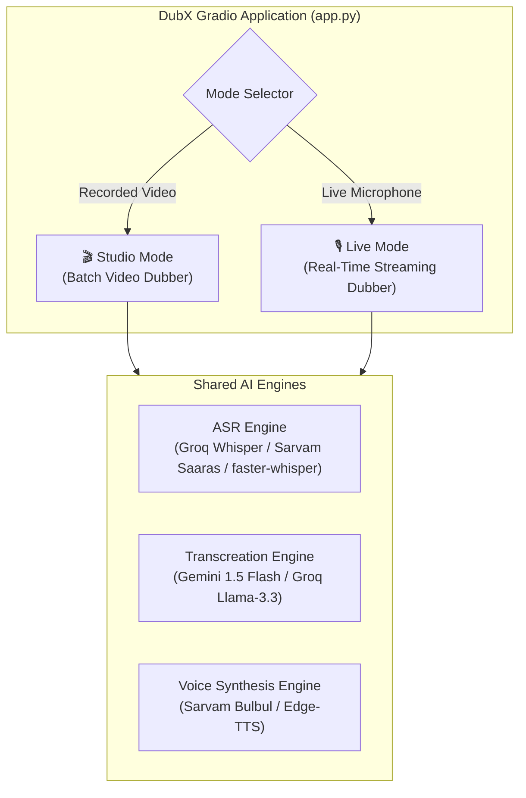
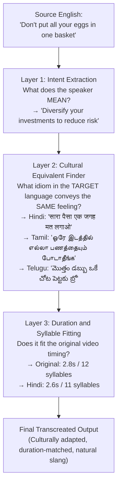
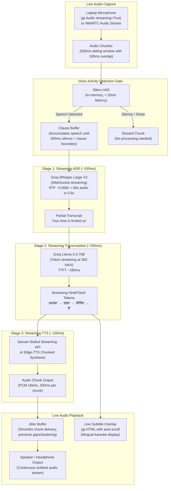

```mermaid
flowchart TD
    subgraph Input["Phase 0: Ingestion"]
        V["Video Input\n(MP4 Upload / YouTube URL)"]
        V --> YT["yt-dlp Downloader\n(if YouTube URL)"]
        YT --> SRC["source_video.mp4"]
        V -->|Direct Upload| SRC
    end

    subgraph Phase1["Phase 1: Extraction & Transcreation"]
        SRC --> DEMUX["Step 1: FFmpeg Audio Extraction\nffmpeg -vn -acodec pcm_s16le audio.wav"]
        DEMUX --> DEMUCS["Step 2: Demucs v4 Neural Stem Separation\ndemucs --two-stems=vocals audio.wav"]

        DEMUCS --> VOC["vocals.wav\n(Isolated Human Dialogue)"]
        DEMUCS --> BGM["bgm.wav\n(Background Music + SFX + Ambience)"]

        VOC --> ASR["Step 3: Speech-to-Text\n(Groq Whisper Large V3 — sub-1s)\n↳ Fallback: Sarvam Saaras (Indic code-mixing)\n↳ Fallback: faster-whisper (offline)"]
        ASR --> SEG["Word-Level Timestamped Segments\n[{id:1, start:0.0, end:2.4, text:'Your time is limited'}]"]

        SEG --> BUDGET["Step 4a: Syllable Budget Calculator\nTarget = duration × 4.0 syllables/sec\nClamped to ±15% of English syllable count"]
        BUDGET --> TRANS["Step 4b: Gemini 1.5 Flash Transcreation\nDuration-constrained prompt:\n'Translate to colloquial Hindi in ≤14 syllables'"]
        TRANS --> SEGMENTS["Transcreated Segments\n[{id:1, original:'Your time is limited',\n  translated:'आपका वक़्त सीमित है भाई',\n  budget:12, actual:11, pacing:0.92x, status:'🟢'}]"]
    end

    subgraph HITL["Phase 2: Human-in-the-Loop Review"]
        SEGMENTS --> DF["Gradio Editable Dataframe\n(gr.Dataframe interactive=True)"]
        DF --> EDIT["User Reviews & Edits:\n- Fix cultural idioms\n- Adjust syllable pacing\n- AI Auto-Trim flagged segments"]
        EDIT --> APPROVED["Approved Script\n(Locked segments with final translations)"]
    end

    subgraph Phase3["Phase 3: Voice Synthesis & Audio Mastering"]
        APPROVED --> CLONE["Step 5: Voice Clone TTS\n(Per-Segment Synthesis)"]
        VOC -.->|Reference Voice Embedding| CLONE

        CLONE --> PRIMARY["Primary: Sarvam Bulbul V3\n(Native Indian cadence, ₹100 free credits)"]
        CLONE --> FALLBACK["Fallback: Edge-TTS\n(100% free, zero API key)\nhi-IN-MadhurNeural / ta-IN-ValluvarNeural"]

        PRIMARY --> RAW["Raw Dubbed Audio Segments\nseg_001.wav, seg_002.wav, ..."]
        FALLBACK --> RAW

        RAW --> STRETCH["Step 6: Per-Segment Time-Stretching\n(pyrubberband phase-vocoder)\nClamp: 0.85x to 1.18x speed ratio"]
        STRETCH --> CONCAT["Concatenated Dubbed Vocal Track\ndubbed_vocals.wav"]

        CONCAT --> DUCK["Step 7: Dynamic Sidechain Ducking\n(FFmpeg sidechaincompress)"]
        BGM --> DUCK

        DUCK --> MASTER["Mastered Audio\n(Voice loud & clear + BGM ducked -10dB during speech,\nswells back up during pauses)"]
    end

    subgraph Phase4["Phase 4: Final Render & Export"]
        MASTER --> REMUX["Step 8: FFmpeg 1-Pass Remux\n-c:v copy (zero video re-encoding)\n-c:a aac -b:a 192k"]
        SRC -.->|Original Video Stream| REMUX

        SEGMENTS --> SUBS["Step 9: Subtitle Generation\n.srt + .vtt with Noto Sans Indic\n(HarfBuzz complex ligature shaping)"]

        REMUX --> FINAL["final_dubbed_video.mp4"]
        SUBS --> SRT["subtitles.srt / subtitles.vtt"]
    end

    subgraph Output["Phase 5: Output & Comparison"]
        FINAL --> PLAYER["Synchronized Side-by-Side Player\n(Original vs Dubbed)"]
        FINAL --> AB["Mid-Playback A/B Audio Switcher\n[🇬🇧 English] ↔ [🇮🇳 Tamil]"]
        FINAL --> DL["Downloads: MP4, SRT, VTT, Stems ZIP"]
        SRT --> PLAYER
    end
```

# DubX — Dual-Mode Architecture: Studio + Live Real-Time

---

## System Overview

DubX operates as a **Dual-Mode AI Dubbing Studio** inside a single Gradio application. Both modes share core AI engines but differ fundamentally in **data flow, latency targets, and BGM handling**.



---

## Mode 1: 🎬 Studio Mode (Batch Video Dubber)

### Purpose
Dub pre-recorded videos (YouTube, MP4 uploads, EdTech lectures) with **maximum quality**, background music preservation, human review of translations, and polished final export.

### Target Latency
- **10 to 25 seconds** for a 60-second video (acceptable — user waits for a polished output).

### Architecture Diagram



### Detailed Step-by-Step Data Flow

| Step | What Happens | Input | Output | Engine | Latency |
| :--- | :--- | :--- | :--- | :--- | :--- |
| **1** | Extract audio from video container | `source.mp4` | `audio.wav` (PCM 44.1kHz) | FFmpeg | ~0.1s |
| **2** | Separate voice from background music using neural network | `audio.wav` | `vocals.wav` + `bgm.wav` | Demucs v4 (HTDemucs) | ~4–8s |
| **3** | Transcribe voice with word-level timestamps | `vocals.wav` | `[{start, end, text}]` JSON segments | Groq Whisper / Sarvam | ~0.8s |
| **4a** | Calculate syllable budget per segment | Segments + durations | Target syllable count per segment | Local Python (Akshara counter) | ~0.01s |
| **4b** | Translate with duration constraints and colloquial style | English segments + budgets | Regional translated segments | Gemini 1.5 Flash | ~0.5–1.0s |
| **5** | *(User Review)* Edit translations in interactive table | Dataframe | Approved locked segments | Human | User-paced |
| **6** | Synthesize regional speech in the speaker's cloned voice | Translated text + reference voice | `seg_001.wav, seg_002.wav, ...` | Sarvam Bulbul / Edge-TTS | ~1.5–3.0s |
| **7** | Time-stretch each segment to fit original video timing | Raw TTS segments + target durations | Duration-matched segments | pyrubberband | ~0.3s |
| **8** | Duck BGM during speech, swell during pauses | `dubbed_vocals.wav` + `bgm.wav` | `mastered_audio.m4a` | FFmpeg sidechaincompress | ~1.2s |
| **9** | Remux mastered audio with original video (no re-encode) | Video stream + mastered audio | `final_dubbed.mp4` | FFmpeg `-c:v copy` | ~0.3s |
| **10** | Generate bilingual subtitle files | Timestamped segments | `.srt` + `.vtt` | pysrt + Noto Sans | ~0.05s |

### How Background Music Is Retained (Studio Mode)

```
Original Mixed Audio:  ██████████ VOICE ██████████ BGM ██████████ SFX ██████████

                              ↓ Demucs v4 Neural Separation ↓

Isolated Vocals:       ██████████ VOICE ██████████ .......... ██████████ ..........
Isolated BGM + SFX:    .......... .......... ██████████ BGM ██████████ SFX ██████████

                              ↓ AI Dubbing Pipeline (ASR → Translate → TTS) ↓

New Regional Vocals:   ██████████ हिंदी VOICE █████████ .......... ██████████ ..........

                              ↓ Sidechain Ducking (FFmpeg) ↓

Final Mastered Audio:  ██ हिंदी VOICE (LOUD) ██ BGM (DUCKED -10dB) ██ BGM (FULL) ██ SFX ██
                       ↑ Voice is clear            ↑ Music dips         ↑ Music swells back
```

---

## The Transcreation Engine: Preserving Metaphors, Idioms & Meaning Across All Regional Languages

### The Core Problem: Translation Destroys Meaning

Standard AI translation (Google Translate, DeepL, even basic LLM calls) produces **literal word-for-word output** that destroys the speaker's intent. In dubbing, this is fatal — the audience hears nonsensical phrases and immediately disconnects.

| Original English | ❌ Literal Translation (Hindi) | What It Actually Means | ✅ DubX Transcreation (Hindi) |
| :--- | :--- | :--- | :--- |
| *"That's a steal at this price!"* | *"इस कीमत पर यह एक चोरी है!"* (This is a theft!) | It's a great bargain | *"इस कीमत पर तो लूट मची है भाई!"* |
| *"He hit it out of the park"* | *"उसने इसे पार्क से बाहर मारा"* (Physically hitting a park) | He did an exceptional job | *"उसने तो कमाल कर दिया!"* |
| *"Don't put all your eggs in one basket"* | *"अपने सभी अंडे एक टोकरी में मत रखो"* (Literally about eggs) | Diversify your risk | *"सारा पैसा एक जगह मत लगाओ"* |
| *"The market is on fire"* | *"बाज़ार में आग लगी है"* (The market is literally burning) | The market is booming | *"बाज़ार में तो धूम मची है!"* |
| *"Bear market incoming"* | *"भालू बाज़ार आ रहा है"* (A bear animal market) | Stock market decline | *"मंदी आने वाली है भाई"* |

DubX does **not** translate. It **transcreates** — preserving the **intent, emotion, rhetorical device, and cultural impact** of every sentence.

---

### 3-Layer Transcreation Pipeline



---

### Per-Language Cultural Profiles

Every language has its own **soul** — the same English metaphor requires a **different cultural equivalent** in Hindi vs Tamil vs Telugu vs Bengali. There is no universal "Indian translation."

#### Language Profile Configuration (used by Gemini 1.5 Flash)

| Language | Dialect Used | Casual Tone Markers | Proverb Style | Keep English As-Is |
| :--- | :--- | :--- | :--- | :--- |
| **Hindi** | Conversational North Indian with Hinglish code-mixing | *bhai, yaar* (भाई, यार) | Hindi muhavare (मुहावरे), NOT Sanskrit shlokas | subscribe, like, share, portfolio, mutual fund, SIP, returns, market |
| **Tamil** | Spoken colloquial Tamil (பேச்சுத் தமிழ்), NOT literary Sentamizh | *da, di, pa* (டா, டி, பா) | Tamil pazhamozhi (பழமொழி) + Chennai slang | subscribe, like, share, phone, app, invest, stock market |
| **Telugu** | Conversational Hyderabadi / Coastal Telugu with modern slang | *bro, ra, ri* (బ్రో, రా, రి) | Telugu saamethalu (సామెతలు) + Tollywood references | subscribe, like, share, invest, market, feature, update |
| **Bengali** | Colloquial Kolkata Bengali (চলিত ভাষা), NOT Sadhu Bhasha | *re, tui* (রে, তুই) | Bengali probad (প্রবাদ) + Bangla cinema references | subscribe, like, share, invest, market, phone, online |
| **Kannada** | Spoken Bengaluru Kannada with modern slang | *maga, guru* (ಮಗಾ, ಗುರು) | Kannada gadegalu (ಗಾದೆಗಳು) + local references | subscribe, like, share, invest, app, update, feature |
| **Marathi** | Colloquial Puneri / Mumbai Marathi | *re, ya* (रे, या) | Marathi mhani (म्हणी) + cultural references | subscribe, like, share, invest, market, SIP, returns |

---

### Cross-Language Metaphor Adaptation Examples

#### One Sentence → Six Different Transcreations:

**English:** *"Don't put all your eggs in one basket"*

| Language | ❌ Literal Translation | ✅ DubX Transcreation |
| :--- | :--- | :--- |
| **Hindi** | अपने सभी अंडे एक टोकरी में मत रखो | **सारा पैसा एक जगह मत लगाओ भाई** |
| **Tamil** | உங்கள் முட்டைகளை ஒரு கூடையில் வைக்காதீர்கள் | **ஒரே இடத்தில் எல்லா பணத்தையும் போடாதீங்க** |
| **Telugu** | మీ గుడ్లన్నీ ఒకే బుట్టలో పెట్టకండి | **మొత్తం డబ్బు ఒకే చోట పెట్టకు బ్రో** |
| **Bengali** | সব ডিম এক ঝুড়িতে রেখো না | **সব টাকা এক জায়গায় ঢালিস না রে** |
| **Kannada** | ನಿಮ್ಮ ಮೊಟ್ಟೆಗಳನ್ನೆಲ್ಲಾ ಒಂದೇ ಬುಟ್ಟಿಯಲ್ಲಿ ಇಡಬೇಡಿ | **ಎಲ್ಲಾ ದುಡ್ಡನ್ನ ಒಂದೇ ಕಡೆ ಹಾಕಬೇಡ ಮಗಾ** |
| **Marathi** | तुमची सगळी अंडी एकाच टोपलीत ठेवू नका | **सगळा पैसा एकाच ठिकाणी लावू नकोस रे** |

#### Tech Creator Context (MKBHD style):

| English | Hindi | Tamil | Telugu |
| :--- | :--- | :--- | :--- |
| *"This phone is a beast!"* | *"ये फोन तो जानवर है भाई!"* | *"இந்த போன் ஒரு மிருகம் டா!"* | *"ఈ ఫోన్ ఒక బీస్ట్ రా!"* |
| *"It blew my mind"* | *"मेरा दिमाग हिल गया"* | *"என் மண்டையே போச்சு டா"* | *"నా బుర్ర పనిచేయడం ఆపేసింది"* |
| *"This feature is a game changer"* | *"ये फीचर तो गेम चेंजर है"* | *"இந்த ஃபீச்சர் கேம் சேஞ்சர் டா"* | *"ఈ ఫీచర్ గేమ్ చేంజర్ బ్రో"* |

#### Finance Creator Context:

| English | Hindi | Tamil | Bengali |
| :--- | :--- | :--- | :--- |
| *"The market is on fire!"* | *"मार्केट में तो धूम मची है!"* | *"மார்க்கெட் தீ பிடிச்சு எரியுது!"* | *"মার্কেটে আগুন লেগেছে রে!"* |
| *"This stock is a hidden gem"* | *"ये स्टॉक छुपा हुआ हीरा है"* | *"இந்த ஸ்டாக் ஒரு hidden gem டா"* | *"এই স্টকটা লুকানো রত্ন রে"* |
| *"Don't chase returns blindly"* | *"आंख बंद करके रिटर्न्स के पीछे मत भागो"* | *"கண்ணு மூடி ரிட்டர்ன்ஸ் பின்னாடி ஓடாதீங்க"* | *"চোখ বুজে রিটার্নের পেছনে ছুটিস না"* |

#### Motivational / Emotional Context:

| English | Hindi | Tamil | Telugu | Marathi |
| :--- | :--- | :--- | :--- | :--- |
| *"Stay hungry, stay foolish"* | *"जुनून मत छोड़ो, हिम्मत मत हारो"* | *"ஆர்வத்தை விடாதீர்கள், துணிச்சலை இழக்காதீர்கள்"* | *"ఆకలిగా ఉండు, సాహసంగా ఉండు"* | *"जिद्द सोडू नकोस, धाडस हरवू नकोस"* |
| *"Your time will come"* | *"तेरा टाइम आएगा भाई"* | *"உன் நேரம் வரும் டா"* | *"నీ టైం వస్తుంది రా"* | *"तुझा वेळ येईल रे"* |
| *"Fall seven times, stand up eight"* | *"सात बार गिरो, आठवीं बार उठो"* | *"ஏழு தடவை விழு, எட்டாவது தடவை எழு"* | *"ఏడు సార్లు పడు, ఎనిమిదో సారి లే"* | *"सात वेळा पड, आठव्यांदा उभा रहा"* |

---

### The 7 Transcreation Rules (Enforced via Gemini System Prompt)

These rules are dynamically injected into the Gemini 1.5 Flash system prompt for every transcreation request:

```
RULE 1: NEVER TRANSLATE LITERALLY
  → You are a TRANSCREATOR, not a translator.
  → Preserve INTENT, EMOTION, and RHETORICAL IMPACT — NOT individual words.

RULE 2: METAPHOR → CULTURAL EQUIVALENT
  → English metaphor → Find the EQUIVALENT metaphor in the target language.
  → "Piece of cake" → Hindi: "बाएं हाथ का खेल" (NOT "केक का टुकड़ा")
  → "Break a leg" → Tamil: "வெற்றி பெறு டா" (NOT "காலை உடை")

RULE 3: PROVERBS → PROVERBS
  → Map to the equivalent regional proverb with the SAME moral lesson.
  → Never translate a proverb word-for-word.

RULE 4: HUMOR & SARCASM PRESERVATION
  → Sarcastic tone MUST sound equally sarcastic in the regional language.
  → "Oh great, another meeting" → Hindi: "वाह, एक और मीटिंग... क्या बात है"

RULE 5: TECHNICAL JARGON HANDLING
  → Keep universally understood terms as-is in regional script:
    "portfolio" → "पोर्टफोलियो" (NOT "विभाग")
    "mutual fund" → "म्यूचुअल फंड" (NOT "पारस्परिक निधि")
    "subscribe" → "सब्सक्राइब" (NOT "सदस्यता लें")
  → This is how real Indian creators speak (Hinglish / Tanglish / Tenglish).

RULE 6: EMOTIONAL MARKERS
  → Preserve exclamation marks, rhetorical questions, dramatic pauses
    in the exact same sentence positions.
  → "And you know what happened next?!" → "और फिर पता है क्या हुआ?!"

RULE 7: SYLLABLE BUDGET
  → Output MUST be speakable within the original segment's duration.
  → Target: ~4 syllables/second for Indic languages.
  → If the natural translation is too long, SHORTEN it using punchy
    vernacular phrasing while keeping the core meaning.
```

---

### Why This Matters: The Competitive Moat

| Aspect | Standard Translation (All Competitors) | DubX Transcreation Engine |
| :--- | :--- | :--- |
| **Metaphors** | Destroyed (translated word-for-word) | **Adapted to per-language cultural equivalent** |
| **Humor / Sarcasm** | Lost (sounds flat or confusing) | **Tone, timing, and energy preserved** |
| **Technical Terms** | Over-translated into formal Sanskrit/classical words nobody uses | **Kept as Hinglish/Tanglish (how real Indians actually speak)** |
| **Proverbs** | Word-for-word nonsense in every language | **Mapped to equivalent regional proverb with same moral** |
| **Emotional Energy** | Flattened into monotone text | **Exclamation, drama, rhetorical questions intact** |
| **Regional Dialects** | One generic "Hindi" / "Tamil" for all contexts | **Puneri vs Mumbai Marathi, Hyderabadi vs Coastal Telugu, Chennai vs formal Tamil** |
| **Code-Mixing** | Fails on Hinglish/Tanglish mid-sentence switches | **Natively handles bilingual vocabulary within the same sentence** |

---

## Mode 2: 🎙️ Live Mode (Real-Time Streaming Dubber)

### Purpose
Dub speech **as it is being spoken** — the regional voice plays out of the speakers within ~1.5 to 2.0 seconds of the person speaking. Used for live webinars, Zoom/Teams meetings, YouTube Live, and **live hackathon demos to prove real-time capability to judges**.

### Target Latency
- **< 2.0 seconds** end-to-end (from speaker's mouth to dubbed audio out).

### Architecture Diagram



### Detailed Step-by-Step Data Flow

| Step | What Happens | Latency | Detail |
| :--- | :--- | :--- | :--- |
| **1. Audio Capture** | Gradio captures mic audio in **500ms sliding chunks** with 100ms overlap. | ~0ms | `gr.Audio(sources=["microphone"], streaming=True, every=0.5)` sends raw PCM to the Python callback. |
| **2. Voice Activity Detection** | Silero-VAD analyzes each chunk: is the user speaking or is it silence/background noise? | ~20ms | If silence, chunk is discarded (no downstream processing = no wasted API calls). If speech, chunk is appended to a **clause buffer**. |
| **3. Clause Boundary Detection** | Buffer accumulates speech until it detects **300ms of continuous silence** (a natural pause between clauses or sentences). | Variable | This ensures we send complete, meaningful phrases to the translator (not half-words). Example: buffer accumulates *"Your time is limited"* → 300ms silence detected → flush to ASR. |
| **4. Streaming ASR** | The complete clause audio is sent to **Groq Whisper Large V3** via API. Groq's custom LPU hardware transcribes 60 seconds of audio in ~0.6 seconds. | **~150ms** | Returns: `{"text": "Your time is limited", "language": "en"}` |
| **5. Streaming Transcreation** | The English transcript is immediately sent to **Groq Llama-3.3-70B** (or Gemini Flash) with a concise system prompt: *"Translate to conversational Hindi. Keep it short and natural."* Groq streams tokens at 300 tokens/sec. | **~200ms (TTFT)** | First Hindi token arrives in ~200ms. Full clause translation completes in ~400ms. Tokens are forwarded to TTS as they arrive (pipelining). |
| **6. Streaming TTS** | As translated tokens accumulate (every 4-5 words), they are sent to **Sarvam Bulbul** (or Edge-TTS) for audio synthesis. The TTS engine returns audio chunks progressively. | **~150ms (TTFA)** | First audio chunk plays while the LLM is still generating the rest of the translated sentence. |
| **7. Jitter Buffer & Playback** | A 200ms jitter buffer smooths audio chunk delivery, preventing gaps or stuttering from network jitter. The dubbed audio plays continuously through the speakers. | ~200ms (buffer) | The user hears the dubbed sentence **~1.5 to 2.0 seconds** after they finished speaking it. |
| **8. Live Subtitles** | Translated text is simultaneously rendered on-screen in a scrolling bilingual subtitle overlay (English + Hindi/Tamil). | Real-time | Uses `gr.HTML` with auto-scrolling div and Noto Sans Indic fonts. |

### How Background Music / Audio Is Handled (Live Mode)

Live mode handles BGM **completely differently** from Studio mode:

```
┌─────────────────────────────────────────────────────────────┐
│                  STUDIO MODE (Recorded Video)                │
│                                                              │
│  Problem: Video has ONE mixed audio track (voice + music)    │
│  Solution: Demucs v4 neural separation (4-8 seconds)         │
│                                                              │
│  [Mixed Audio] → [Demucs AI] → [vocals.wav] + [bgm.wav]     │
└─────────────────────────────────────────────────────────────┘

┌─────────────────────────────────────────────────────────────┐
│                  LIVE MODE (Real-Time Mic)                    │
│                                                              │
│  Scenario A: Mic-only input (webinar, Zoom call)             │
│  → Mic captures ONLY voice (no BGM to separate!)             │
│  → Zero separation needed. Voice goes directly to ASR.       │
│                                                              │
│  Scenario B: Presenter with background music (YouTube Live)  │
│  → OBS / streaming software routes mic and desktop audio     │
│    on SEPARATE tracks natively.                              │
│  → DubX processes ONLY the mic track.                        │
│  → Original desktop BGM passes through untouched.            │
│                                                              │
│  Scenario C: Single mixed stream (rare edge case)            │
│  → DeepFilterNet causal filter isolates voice in < 20ms      │
│  → Ultra-lightweight (no Demucs needed for real-time)        │
└─────────────────────────────────────────────────────────────┘
```

---

## Side-by-Side Comparison: Studio vs Live

| Dimension | 🎬 Studio Mode | 🎙️ Live Mode |
| :--- | :--- | :--- |
| **Input** | Pre-recorded MP4 / YouTube URL | Live microphone / WebRTC stream |
| **Processing Model** | **Batch:** Full video → full pipeline → final render | **Streaming:** 500ms chunks → clause-by-clause → instant playback |
| **Total Latency** | 10–25 seconds (for 60s video) | **< 2.0 seconds** (per clause) |
| **BGM Handling** | Demucs v4 neural stem separation (4–8s) | Mic track is already clean voice (zero separation) |
| **Sidechain Ducking** | FFmpeg `sidechaincompress` (post-processing) | Native audio routing (BGM on separate OBS track) |
| **Human-in-the-Loop** | ✅ Yes — editable `gr.Dataframe` for script review | ❌ No — fully automatic, no pause possible |
| **Translation Quality** | **Highest** — full-sentence context + syllable budgeting | **Good** — clause-level context (shorter window) |
| **Voice Cloning** | ✅ Full reference embedding from isolated vocals | ⚠️ Limited — short reference clip, or pre-set voices |
| **ASR Engine** | Groq Whisper (primary) / Sarvam Saaras (Indic) / faster-whisper (offline) | Groq Whisper (streaming, sub-200ms) |
| **Translation Engine** | Gemini 1.5 Flash (1M TPM free, best Indic nuance) | Groq Llama-3.3-70B (300 tok/s, lowest TTFT) |
| **TTS Engine** | Sarvam Bulbul (primary) / Edge-TTS (free fallback) | Edge-TTS chunked (primary, zero-cost) / Sarvam streaming |
| **Output Format** | Dubbed `.mp4` + `.srt` + `.vtt` + stems `.zip` | Live audio stream + scrolling bilingual subtitles |
| **Best For** | YouTube, EdTech courses, Reels, OTT films, product videos | Live webinars, Zoom, YouTube Live, hackathon judge test |

---

## Unified Codebase Architecture

```
regionaldubbing/
├── app.py                          # Main Gradio app with tab selector
│
├── studio/                         # 🎬 Studio Mode (Batch Video)
│   ├── tab_input.py                #   Tab 1: Video upload / YouTube / settings
│   ├── tab_pipeline.py             #   Tab 2: Live progress stepper & log
│   ├── tab_review.py               #   Tab 3: Human-in-the-loop dataframe editor
│   └── tab_output.py               #   Tab 4: Side-by-side player & A/B switcher
│
├── live/                           # 🎙️ Live Mode (Real-Time)
│   ├── tab_live.py                 #   Mic capture, live subtitles, playback
│   ├── vad.py                      #   Silero-VAD clause boundary detector
│   ├── clause_buffer.py            #   Accumulates speech chunks until pause
│   └── stream_orchestrator.py      #   Async pipeline: ASR → LLM → TTS streaming
│
├── pipeline/                       # Shared AI Engines (used by both modes)
│   ├── __init__.py
│   ├── asr.py                      #   Groq Whisper / Sarvam Saaras / faster-whisper
│   ├── transcreation.py            #   Gemini Flash (batch) / Groq Llama (streaming)
│   ├── tts.py                      #   Sarvam Bulbul / Edge-TTS (dual-engine fallback)
│   ├── demux.py                    #   Demucs v4 stem separation (Studio only)
│   ├── realignment.py              #   pyrubberband time-stretching (Studio only)
│   ├── remux.py                    #   FFmpeg ducking & remuxing (Studio only)
│   └── orchestrator.py             #   Generator-based pipeline orchestrator
│
├── utils/
│   ├── syllable_budget.py          #   Indic Akshara & English syllable counter
│   ├── audio_utils.py              #   Loudness normalization, resampling
│   ├── video_utils.py              #   yt-dlp, duration extraction
│   ├── subtitles.py                #   SRT/VTT generation with HarfBuzz shaping
│   └── sync_player.js              #   Bi-directional video sync JavaScript
│
├── state.py                        # Session state dataclasses
├── config.py                       # API keys, voice maps, language codes
├── demo_cache/                     # Pre-rendered zero-latency demo clips
│   ├── steve_jobs/
│   ├── khan_academy/
│   └── tech_creator/
├── assets/
│   ├── styles.css                  # Custom CSS for progress stepper & dark mode
│   └── fonts/                      # Noto Sans Devanagari, Tamil, Telugu
├── requirements.txt
└── README.md
```

---

## The Hackathon Demo Strategy (Using Both Modes)

### During the 2-Minute Pitch:

| Timestamp | What Happens | Mode Used |
| :--- | :--- | :--- |
| **0:00 – 0:25** | Problem statement & killer stat | Slides |
| **0:25 – 0:45** | Solution, business model, unit economics | Slides |
| **0:45 – 1:15** | What AI automates (before vs after workflow) | Slides |
| **1:15 – 1:30** | **Pre-cached Steve Jobs demo** — click A/B switcher mid-sentence, English flips to Tamil seamlessly | 🎬 Studio Mode |
| **1:30 – 1:45** | **Live mic demo** — presenter speaks English into mic, audience hears Hindi from speakers in 1.5 seconds | 🎙️ Live Mode |
| **1:45 – 2:00** | Impact, market size, close | Slides |

> The Studio demo proves **production-grade video dubbing with BGM preservation**.  
> The Live demo proves **real-time capability and eliminates any doubt of pre-recording**.  
> Together, they cover the full market and make DubX unbeatable.
