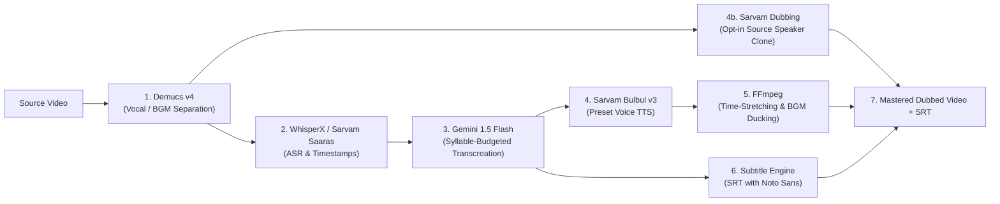

# DubX — AI Regional Content Dubbing Pipeline

> **Democratizing video content for the next billion users by dubbing videos into regional Indic languages while preserving the speaker's original voice identity, background music, and emotional cadence.**

---

## 📌 Project Overview
- **Category:** Media • Localisation  
- **Event:** CODE कलेश 2026 — One Night Hackathon  
- **Envelope:** 03 of 89  
- **GitHub Repository:** [https://github.com/Akshit99999/DubX](https://github.com/Akshit99999/DubX)

---

## 📑 Documentation Links
- [**Problem Statement & Brief**](./PROBLEM_STATEMENT.md): Official hackathon prompt, problem definition, and team deliverables.
- [**Research, Architecture & Go-to-Market Strategy**](./RESEARCH_AND_STRATEGY.md): Comprehensive market analysis, competitor failure points, 7-stage technical pipeline, unit economics (88.5% margin), 5-slide deck structure, and 2-minute pitch script.

---

## 🎯 The Problem
Creators reach one language audience and stop. Traditional studio dubbing costs **₹1,000 – ₹1,800/min** ($12 – $22/min), taking 7–14 days. Consequently:
- **90% of India's next 500 million internet users consume content exclusively in regional languages.**
- Yet, **less than 5% of digital content** is available in Indian vernacular languages.
- Over **56% of Indian OTT viewing** is now in regional languages, officially surpassing Hindi and English combined (FICCI-EY 2025).

---

## 💡 The Solution: DubX
DubX provides a 1-click AI pipeline that transforms any video into regional languages in **under 3 minutes at less than 1% of the cost (₹25–₹30/min)**.

---

## 🎨 Product Experience & Design Philosophy

> Designed with the clean, minimalist, and tool-focused simplicity of iLovePDF, our web platform turns video dubbing into Indian regional languages into an effortless, one-click experience. Users can seamlessly supply content using three flexible input methods: uploading a local video file, recording directly through a live camera, or pasting a video URL. Once processed by our translation engine, the platform offers three distinct output choices: downloading the fully dubbed regional video, extracting just the localized audio track as a standalone file, or generating a complete text transcript of the translated speech in the chosen regional language. Whether for content creators, educators, or media teams, this streamlined tool removes complex software barriers and makes multi-format regional content localization accessible to anyone in seconds.

### The 3-Input ➔ 3-Output Simplicity
```
INPUT METHODS:
  [📁 Local Video Upload]  |  [📹 Live Camera Record]  |  [🔗 Paste Video URL]
                                      ↓
                   ⚡ DubX Regional AI Translation Engine
                                      ↓
OUTPUT CHOICES:
  [🎬 Fully Dubbed Video]  |  [🎧 Localized Audio Track]  |  [📄 Translated Transcript]
```

---

### Core Innovations
1. **Cross-Lingual Voice Timbre Preservation:** Uses zero-shot voice cloning to preserve the speaker's pitch, timbre, and emotion across Indic languages.
2. **Intelligent Background Music & SFX Isolation:** Employs `Demucs v4` stem separation to keep background scores and Foley sound effects 100% intact with dynamic sidechain ducking.
3. **Colloquial Transcreation Engine:** Prompt-engineered LLM translation enforcing **syllable/duration budgeting** to prevent speech-video drift and translate natural slang (Hinglish/Tanglish) rather than literal textbook phrasing.
4. **Bilingual Subtitle Generation:** Automatic synced `.srt`/`.vtt` with native Indic font shaping (HarfBuzz + Noto Sans).
5. **Text to Regional Audio Dubbing:** Input any English text, phrase, or idiom and instantly generate culturally transcreated regional audio (MP3) without losing meaning or metaphors.
6. **Dynamic Dual-Language Code-Mixing Matrix:** Blend any two configured languages (Hindi + Punjabi, Hinglish, Tanglish, Tenglish, and more) with intensity and native/romanized/dual-script output.

---

## 🎯 The Complete Dubbing Suite (`dubx_core.py`)

DubX supports five distinct, flexible dubbing modes to serve creators, educators, and enterprise media teams:

```
┌──────────────────────────────────────────────────────────────────────────────────┐
│                           THE DUBX DUBBING SUITE                                 │
│                                                                                  │
│  1. 📝 TEXT-TO-TEXT DUBBING (Transcreation Engine)                               │
│     English Text ➔ Intent Extraction ➔ Cultural Regional Text                    │
│                                                                                  │
│  2. 🔊 TEXT-TO-AUDIO DUBBING                                                     │
│     English Text ➔ Transcreation ➔ Regional Neural Voice Audio (MP3)             │
│                                                                                  │
│  3. 🎙️ AUDIO-TO-AUDIO DUBBING                                                     │
│     Source Audio ➔ Whisper ASR ➔ Transcreation ➔ Regional Dubbed Audio          │
│                                                                                  │
│  4. 🎬 VIDEO-TO-VIDEO DUBBING (Clean / Softsub)                                  │
│     Source Video ➔ Audio Extract ➔ ASR ➔ Voice Dub ➔ Lossless Remux + SRT File   │
│                                                                                  │
│  5. 📺 VIDEO-TO-VIDEO + CAPTIONS (Hardsub Burn-in for Reels/Shorts)              │
│     Source Video ➔ Voice Dub ➔ Styled Regional Captions Burned into Video        │
└──────────────────────────────────────────────────────────────────────────────────┘
```

### CLI Usage (`dubx_core.py`):

```bash
# 1. Text-to-Text Dubbing (Transcreation without losing meaning)
python dubx_core.py --mode t2t --input "Don't put all your eggs in one basket" --lang hindi

# 2. Text-to-Audio Dubbing (Transcreation + Speech Synthesis)
python dubx_core.py --mode t2a --input "That's a steal at this price!" --lang tamil --gender female

# 3. Audio-to-Audio Dubbing with a Sarvam preset voice
python dubx_core.py --mode a2a --input lecture_clip.mp3 --lang telugu --source-lang english

# 3b. Source-speaker preservation with Sarvam Dubbing (requires rights-holder consent)
python dubx_core.py --mode a2a --input lecture_clip.mp3 --lang telugu --source-lang english --clone-speaker --confirm-voice-consent

# 4. Video-to-Video Dubbing (Lossless Video + Dubbed Audio + Separate Subtitles)
python dubx_core.py --mode v2v --input source_video.mp4 --lang hindi --source-lang english

# 5. Video-to-Video + Captions (Dubbed Audio + Styled Captions Burned into Video)
python dubx_core.py --mode v2v_caption --input reel_clip.mp4 --lang tamil --source-lang english
# OR
python dubx_core.py --mode v2v --input reel_clip.mp4 --lang tamil --caption
```

### Supported Languages & Sarvam Audio

DubX supports English, Punjabi, Hindi, Tamil, Telugu, Bengali, Marathi, Kannada, Gujarati, Malayalam, and the Hinglish/Tanglish/Tenglish aliases. Text-only output uses Sarvam Bulbul v3. Audio and video can use Sarvam Dubbing’s source-speaker preservation only when the user deliberately selects that mode and confirms they have permission to clone the speaker.

---

## ⚙️ Technical Architecture



---

## 📊 Business Model & Unit Economics
- **Pricing:** Creator SaaS ($19–$59/mo) + Pay-As-You-Go API ($0.30/min).
- **Unit Economics:** Pipeline compute cost **~$0.04/min (₹3.30/min)** vs. selling price **~$0.35/min (₹29/min)** $\rightarrow$ **88.5% Gross Margin**.
- **Market Size:** Global TAM $6.5B | India SAM $450M–$600M | DubX SOM $15M ARR.

---

## 🚀 Implementation Quickstart

The implementation described in [`implementation.md`](./implementation.md) is now wired into:

- `dubx_core.py` — the five-mode CLI and Python API.
- `app.py` — Studio, Live microphone-clip, and text-demo Gradio tabs.
- `pipeline/` — optional ASR, TTS, transcreation, FFmpeg, stem separation, and remuxing components.
- `utils/` — syllable budgeting, subtitle formatting, and URL ingestion.

Install the Python integrations with `pip install -r requirements.txt`, install FFmpeg separately, and copy `.env.example` to `.env` or export the keys in your shell. DubX reads `SARVAM_API_KEY`, `GEMINI_API_KEY`, and `GROQ_API_KEY` from that file; keys are never hardcoded or committed.

### Audio backend and speaker identity

DubX does not use Edge-TTS. Text-to-audio uses Sarvam Bulbul v3 with a clearly labelled preset voice. Audio/video dubbing defaults to that same preset mode, so it does not claim the output is the original speaker.

The Studio defaults to **Clone original speaker with Sarvam** for audio and video, because it is the only mode that can preserve the source speaker across languages. You must still confirm that you have the right to clone that voice before processing starts. The Sarvam Dubbing workflow returns a source-timeline-aligned dubbed track, translated `.srt`, and—when the source is video—a dubbed video. When captions are enabled (the Studio default), that same Sarvam-aligned subtitle file is burned into the exported video. This opt-in is limited to audio/video inputs; text-only input has no source voice to clone.

Gemini transcreation is register-aware (formal, conversational, or street slang), sees the surrounding ASR dialogue for each timestamped line, and is instructed to preserve named entities, numbers, units, URLs, punctuation, cultural intent, and timing budget without adding invented facts or spoken explanations. This is context-aware transcreation, not direct word-for-word translation.
If Gemini reaches a provider quota, DubX pauses further Gemini attempts briefly and uses its deterministic offline idiom/code-mix fallback rather than repeatedly failing the request.

The offline text demo needs no API key:

```bash
python dubx_core.py --mode t2t --input "Don't put all your eggs in one basket" --lang hindi

# Dynamic dual-language code-mixing (Hindi + Punjabi, native + Roman output)
python dubx_core.py --mode mix --input "Don't put all your eggs in one basket" --primary hindi --secondary punjabi --intensity 2 --script dual
```

Run the web studio with:

```bash
python app.py
```

Studio mode accepts a local upload/recording or a YouTube URL. DubX downloads a single video with `yt-dlp`; only download material you are allowed to process.

Run the offline verification suite with:

```bash
python -m unittest discover -s tests -v
```
