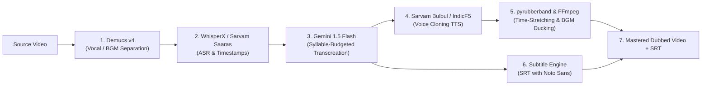

# DubX — AI Regional Content Dubbing Pipeline

> **Democratizing video content for the next billion users by dubbing videos into regional Indic languages while preserving the speaker's original voice identity, background music, and emotional cadence.**

---

## 📌 Project Overview
- **Category:** Media • Localisation  
- **Event:** CODE कलेश 2026 — One Night Hackathon  
- **Envelope:** 03 of 89  
- **GitHub Repository:** [https://github.com/Akshit99999/DubX](https://github.com/Akshit99999/DubX)

---

## 📑 Documentation Links
- [**Problem Statement & Brief**](./PROBLEM_STATEMENT.md): Official hackathon prompt, problem definition, and team deliverables.
- [**Research, Architecture & Go-to-Market Strategy**](./RESEARCH_AND_STRATEGY.md): Comprehensive market analysis, competitor failure points, 7-stage technical pipeline, unit economics (88.5% margin), 5-slide deck structure, and 2-minute pitch script.

---

## 🎯 The Problem
Creators reach one language audience and stop. Traditional studio dubbing costs **₹1,000 – ₹1,800/min** ($12 – $22/min), taking 7–14 days. Consequently:
- **90% of India's next 500 million internet users consume content exclusively in regional languages.**
- Yet, **less than 5% of digital content** is available in Indian vernacular languages.
- Over **56% of Indian OTT viewing** is now in regional languages, officially surpassing Hindi and English combined (FICCI-EY 2025).

---

## 💡 The Solution: DubX
DubX provides a 1-click AI pipeline that transforms any video into regional languages in **under 3 minutes at less than 1% of the cost (₹25–₹30/min)**.

### Core Innovations
1. **Cross-Lingual Voice Timbre Preservation:** Uses zero-shot voice cloning to preserve the speaker's pitch, timbre, and emotion across Indic languages.
2. **Intelligent Background Music & SFX Isolation:** Employs `Demucs v4` stem separation to keep background scores and Foley sound effects 100% intact with dynamic sidechain ducking.
3. **Colloquial Transcreation Engine:** Prompt-engineered LLM translation enforcing **syllable/duration budgeting** to prevent speech-video drift and translate natural slang (Hinglish/Tanglish) rather than literal textbook phrasing.
4. **Bilingual Subtitle Generation:** Automatic synced `.srt`/`.vtt` with native Indic font shaping (HarfBuzz + Noto Sans).

---

## ⚙️ Technical Architecture

---

## 📊 Business Model & Unit Economics
- **Pricing:** Creator SaaS ($19–$59/mo) + Pay-As-You-Go API ($0.30/min).
- **Unit Economics:** Pipeline compute cost **~$0.04/min (₹3.30/min)** vs. selling price **~$0.35/min (₹29/min)** $\rightarrow$ **88.5% Gross Margin**.
- **Market Size:** Global TAM $6.5B | India SAM $450M–$600M | DubX SOM $15M ARR.
