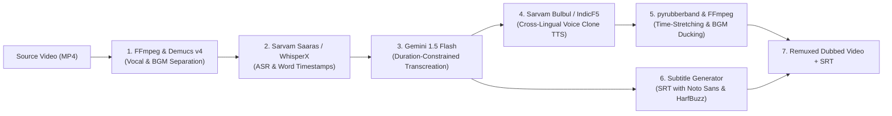

# DubX — Research, Technical Architecture & Go-to-Market Strategy

**Track:** Media • Localisation  
**Event:** CODE कलेश 2026 — One Night Hackathon  
**Envelope:** 03 of 89  

---

## 1. Executive Summary & The Winning Angle

DubX is an end-to-end AI video dubbing pipeline that localizes video content into regional Indian languages while preserving:
1. **The original speaker's vocal identity (timbre, emotion, prosody).**
2. **The background music, ambient audio, and sound effects (via stem separation).**
3. **Colloquial conversational nuances (Hinglish/Tanglish idioms rather than literal textbook translation).**
4. **Natural pacing and video cut synchronization (via duration-constrained LLM prompting and time-stretching).**

### The Core Value Equation
| Metric | Traditional Studio Dubbing | Existing AI (ElevenLabs / HeyGen) | **DubX Pipeline** |
| :--- | :--- | :--- | :--- |
| **Cost / Minute** | ₹1,000 – ₹2,500 ($12 – $30) | ₹125 – ₹250 ($1.50 – $3.00) | **₹25 – ₹30 ($0.30 – $0.35)** |
| **Turnaround (10m Video)**| 5 to 10 days | 15 to 30 minutes | **< 3 minutes** |
| **Speaker Voice Match** | Lost (hired voice actor) | Westernized / generic accent | **Preserved native speaker timbre** |
| **Background Audio** | Erased unless stems provided | Muffled / phase bleed | **Demucs v4 vocal isolation (100% intact BGM)** |
| **Linguistic Naturalness**| High (manual adaptation) | Robotic / textbook Hindi/Tamil | **Contextual transcreation (colloquial slang)** |

---

## 2. Research the Problem

### A. Who Exactly Has This Problem?
1. **YouTube & Digital Creators:** Tech, finance, and edutainment creators (e.g., Technical Guruji, Pranjal Kamra, Akshat Shrivastava) hit an audience ceiling in Hindi/English metros. They cannot expand into South (Tamil, Telugu, Kannada, Malayalam) and East India (Bengali) without hiring costly dubbing studios or launching duplicate channels.
2. **EdTech & Upskilling Platforms:** *PhysicsWallah, Khan Academy India, Unacademy, Adda247*. PhysicsWallah maintains 10+ separate YouTube channels with duplicate faculties for different languages. Localized instruction improves completion rates by 30–40%, but manual studio dubbing across hundreds of lecture hours is cost-prohibitive.
3. **FinTech & BFSI Explainers:** *Zerodha, Groww, PhonePe, Policybazaar*. Complex financial concepts (mutual funds, compounding, insurance riders) sound alien when translated literally. They require contextual, conversational regional explanations to lower Tier-2/3 Customer Acquisition Cost (CAC).
4. **Regional OTT Platforms:** *JioCinema, Aha, Hoichoi, Zee5, SonyLIV*. Over 56% of Indian OTT viewing is in regional languages. Deep content backlogs sit unmonetized in single languages because traditional dubbing takes weeks per season.
5. **Corporate L&D & Gig-Worker Training:** *Zomato, Swiggy, Urban Company, Tata*. Training millions of delivery partners and plant workers requires SOP and safety videos localized into 10+ languages simultaneously.

### B. Current Traditional Dubbing Costs
- **Translation & Transcreation:** ₹300 – ₹600 / min ($3.60 – $7.20)
- **Voice Talent (Actors):** ₹500 – ₹2,500 / min ($6.00 – $30.00)
- **Studio Hire & Sound Engineer:** ₹300 – ₹600 / min ($3.60 – $7.20)
- **Audio Mixing & Mastering:** ₹300 – ₹800 / min ($3.60 – $9.60)
- **Lip-Sync Adaptation & QA:** ₹200 – ₹500 / min ($2.40 – $6.00)
- **Total Standard Quality:** **₹1,000 – ₹1,800 / minute** ($12 – $22/min) per language.
- **The Math:** Dubbing a single **20-minute video** into **5 languages** costs **₹1,20,000 (~$1,450)** and takes **7 to 14 business days**.

### C. Competitive Landscape & Deep Failure Gaps
| Competitor | Positioning | Critical Gaps in Indian Regional Dubbing |
| :--- | :--- | :--- |
| **Dubverse.ai** | India AI dubbing (60+ languages) | Flat/instructional emotion; high lip-sync credit pricing; background audio bleed. |
| **ElevenLabs** | Global voice cloning leader | Accent drift in regional Indic languages; fails on Hinglish/Tanglish code-mixing; no integrated video/BGM pipeline. |
| **HeyGen** | AI talking-head avatars | Expensive ($2–$3/min); avatar-focused; lacks native Indic voice prosody. |
| **Murf.ai** | Voiceover studio | Pure TTS generator; does not ingest video, transcribe, translate, or preserve BGM. |
| **Camb.ai** | Enterprise localization | Enterprise-only pricing; formal/academic translation lacking regional slang. |
| **Bhashini (Govt)** | Sovereign open-source AI | Monotone/administrative cadence; no voice cloning; no video/BGM processing. |
| **Sarvam AI** | Indic foundation models | API-only infrastructure (*Bulbul*, *Saaras*); lacks turnkey video editor and creator dashboard. |

### D. Market Size (TAM / SAM / SOM)
- **TAM (Global):** **$6.5 Billion** (Global AI Video Localization & Voice Generation market, growing at 24% CAGR to $22B+ by 2034).
- **SAM (India):** **$450 Million – $600 Million (₹3,700 – ₹5,000 Cr)** across Indian OTT, EdTech, Film, and Digital Creator localization. Software-addressable SAM is **~$150M – $200M**.
- **SOM (DubX 24–36 Months):** **$11.4 Million – $15.0 Million ARR (~₹95 – ₹125 Cr)**:
  - 10,000 Indian creators @ $50/mo ($6M/yr)
  - 500 EdTech / FinTech platforms @ $500/mo ($3M/yr)
  - 40 Enterprise OTT / Production houses @ $5,000/mo ($2.4M/yr)

### E. Verifiable Numbers Proving the Problem
1. **Google & KPMG Landmark Study:**  
   > *"9 out of 10 new internet users in India are Indic-language users, yet Indian language content historically accounts for less than 5% of digital content available online."*
2. **FICCI-EY 2025 Media & Entertainment Report:**  
   > *"Regional language content share in OTT video viewing surged from 27% in 2020 to 56% in 2025, officially surpassing Hindi and English content combined."*
3. **YouTube India / Kantar Insights:**  
   > *"Over 93% of YouTube video consumption in India across 500M+ monthly active users is in regional Indic languages; 68% prefer content exclusively in their mother tongue."*

---

## 3. Technical Architecture: The 7-Stage Modular Pipeline

### Stage Deep Dive
1. **Stem Separation (`Demucs v4`):** Isolates the dialogue track into `vocals.wav` and preserves ambient sound/music in `bgm.wav` without phase distortion.
2. **Speech Recognition (`Sarvam Saaras V3` / `WhisperX`):** Generates word-level timestamps and handles code-mixed Indian phonetics (Hinglish/Tanglish).
3. **Colloquial Transcreation (`Gemini 1.5 Flash`):**
   - *The Syllable Budgeting Prompt:* Solves the 15–30% Indic syllable expansion problem by enforcing duration constraints directly during translation.
   - Replaces literal translations with natural vernacular idioms.
4. **Voice-Cloning TTS (`Sarvam Bulbul V3` / `IndicF5` / `ElevenLabs`):** Takes reference vocal timbre from Step 1 and synthesizes regional speech in the creator's exact voice.
5. **Realignment & Ducking (`pyrubberband` + `FFmpeg`):**
   - Performs phase-vocoder time-stretching (within 0.85x–1.15x range) on a per-segment basis to match video scene cuts without "chipmunk" artifacts.
   - Sidechain-ducks background music by -10dB during dialogue.
6. **Subtitles (`libass` + `Noto Sans`):** Burns in or exports synchronized SRT/VTT with full HarfBuzz complex-shaping support for Indian ligatures.
7. **Lip-Sync (Optional / LatentSync):** Can optionally apply Latent Diffusion lip-syncing for talking-head formats.

---

## 4. One-Night Hackathon Build: "Automate ONE Step with AI"

### The Hackathon Prototype Concept
**"Intelligent Syllable-Synchronized Regional Voice Cloak"**
A working interactive web app built in **Streamlit + Python**:
- User uploads a 15–30s English video or inputs a YouTube URL.
- Pipeline extracts audio, transcribes with word timestamps, and applies our **Duration-Constrained Transcreation Engine**.
- Synthesizes regional audio (Hindi / Tamil / Telugu) using cloned voice.
- Aligns and remixes the audio onto the video with dynamic BGM preservation.
- Displays a **Side-by-Side Before & After Player** with synchronized regional subtitles and editable script.

### Tech Stack for the Overnight Build
- **Frontend / Dashboard:** `Streamlit` (Side-by-side video player, interactive timeline/transcript editor).
- **Core Orchestration:** Python 3.11 + `ffmpeg-python`.
- **Speech Recognition:** `faster-whisper` (runs locally in seconds) or `Sarvam Saaras API`.
- **Translation:** `Gemini 1.5 Flash` API (sub-500ms latency, length-constrained prompt).
- **Voice Synthesis:** `Sarvam Bulbul API` or `ElevenLabs Voice Cloning API`.
- **Audio Processing:** `FFmpeg` + `pydub` / `pyrubberband`.

---

## 5. Business Plan & Unit Economics

### Product Offerings
1. **DubX Creator Studio (SaaS):** $19 to $59/month for YouTubers and podcasters (45–180 mins/month, 1-click multi-track export).
2. **DubX Developer API (Usage-Based):** $0.30/minute for EdTech and short-video platforms with automated webhooks.
3. **DubX Enterprise:** Custom annual contracts for OTT catalogs ($5,000–$20,000/year) with dedicated GPU compute and human-in-the-loop review.

### Unit Economics (Cost per Minute of AI Pipeline)
- Demucs stem separation (serverless L4 GPU): ~$0.005 / min
- WhisperX / Saaras STT: ~$0.004 / min
- Gemini 1.5 Flash Transcreation: ~$0.003 / min
- Voice Cloning & TTS (Bulbul / IndicF5): ~$0.025 / min
- Dynamic Realignment & FFmpeg Muxing: ~$0.003 / min
- **Total Compute Cost to DubX:** **~$0.040 / minute (₹3.30 / min)**
- **Selling Price:** **~$0.35 / minute (₹29.00 / min)**
- **Gross Margin:** **88.5%**

---

## 6. Hackathon 5-Slide Presentation Structure

### Slide 1: The Problem & The Real Number
- **Title:** The Vernacular Chasm: 500M Viewers Locked Out.
- **Pain Point:** Creators reach one language and stop. Studio dubbing costs ₹40,000 ($500) per 10-minute video and takes 2 weeks.
- **Killer Stat:** *90% of India's next 500M internet users consume content ONLY in regional languages, yet Indic content represents <5% of digital media.*

### Slide 2: The Solution (DubX) & Value Proposition
- **Title:** DubX: 1-Click Regional Dubbing in the Creator's Own Voice.
- **Key Features:** Cross-lingual voice identity, colloquial transcreation (Hinglish/Tanglish), intelligent BGM preservation, and synced subtitles.
- **Value:** 99% cheaper than traditional studios, 10x faster, zero loss of brand identity.

### Slide 3: What AI Automates (Before vs. After)
- **Title:** From 6 Human Bottlenecks to 1 Automated AI Pipeline.
- **Visual Flow:**
  - *Before:* Script Translation (3 days) $\rightarrow$ Voice Actor Casting (3 days) $\rightarrow$ Studio Recording (1 day) $\rightarrow$ Sound Engineer Mix (2 days) $\rightarrow$ Subtitle Typing (1 day). Total: **10 Days | ₹40,000**.
  - *After:* DubX 1-Click Pipeline (Demucs $\rightarrow$ Whisper $\rightarrow$ Gemini $\rightarrow$ Bulbul $\rightarrow$ FFmpeg). Total: **< 3 Minutes | ₹250**.

### Slide 4: Technical Architecture & Live Demo
- **Title:** Under the Hood: The DubX Syllable-Synchronized Engine.
- **Visuals:** 7-stage architecture diagram + live side-by-side demo showing English original vs. Tamil/Hindi dubbed output with identical speaker timbre and intact background music.

### Slide 5: Business Model, Market Size & Impact
- **Title:** Democratizing Content for the Next Billion Users.
- **Market:** $6.5B Global TAM | $450M India SAM | $15M SOM.
- **Economics:** $0.04 cost vs. $0.35 price = 88.5% gross margin.
- **Impact:** 10x audience reach for creators; high-quality education and tech accessible in every Indian mother tongue.

---

## 7. Two-Minute Pitch Script (120-Second Delivery)

- **[0:00 – 0:25] The Hook & The Real Number (Problem):**  
  *"Over 660 million people watch digital video in India today, and 90% of new internet users consume content exclusively in regional languages. Yet, over 80% of top educational and tech content remains trapped in English and Hindi. Why? Because traditional dubbing is broken. A single 10-minute video costs ₹40,000 in studio fees, requires hiring voice actors, and takes two full weeks. For 99% of creators and teachers, regional dubbing is financially impossible. Today, we're changing that. Meet DubX."*

- **[0:25 – 0:45] The Business & Value Proposition:**  
  *"DubX is an AI pipeline that dubs any video into regional languages in under 3 minutes at less than 1% of the cost — while keeping the original speaker's exact voice character and background music intact. We monetize through a $19/month Creator SaaS and a $0.30/minute API for EdTech and OTT platforms. With our pipeline costing just 4 cents per minute to run, DubX operates at an 88% gross margin while saving creators 99% of their budget."*

- **[0:45 – 1:15] What We Automated (The AI Engine):**  
  *"Here is what AI automates: In a studio, you need six manual handoffs: transcription, translation, voice talent casting, recording, sound mixing, and subtitle timing. DubX automates the entire loop: We isolate the speaker's vocal track from background music using Demucs. We transcribe and transcreate into natural colloquial dialects using Gemini with syllable budgeting. We clone the speaker's voice into Tamil, Telugu, or Bengali using zero-shot Indic voice cloning. And finally, we time-align and remix the audio over the original background score."*

- **[1:15 – 1:45] The Live Demo:**  
  *(Play original English clip 4s) $\rightarrow$ (Play dubbed Tamil/Hindi clip 6s)*  
  *"Notice two things: That is not a generic robotic voice — it is the creator's exact voice and emotional cadence speaking fluent Tamil. And second, the background sound effects and music didn't disappear — they were dynamically ducked and preserved, with synchronized subtitles generated automatically."*

- **[1:45 – 2:00] The Impact & Close:**  
  *"In India, regional video consumption is surging at 56% in a $27 Billion entertainment market. DubX turns every single video into a multi-lingual powerhouse with one click. We are breaking the language barrier so education, knowledge, and entertainment belong to everyone. We are DubX. Thank you!"*
